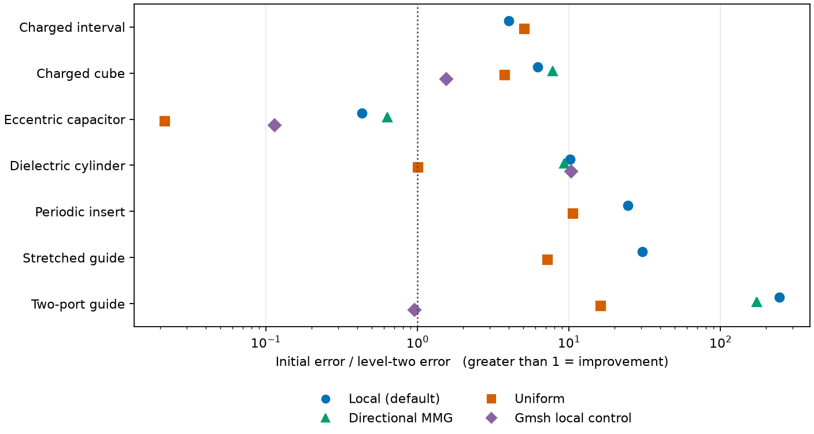

# FEM benchmark results

Measured on 26 November 2026 using FEM [6ada998](https://github.com/SolverNotConverging/FEM/commit/6ada998737b0b08db4daf48a7c1de73a10671f92). Each report includes the model, numerical reference or comparison method, results, a plot and reproduction commands. The October reference measurements are listed separately below.



The figure compares each method with its own problem’s initial mesh. A value of 10 means the observable error fell tenfold. The levels represent refinement budgets. Their DOFs, wall times and memory costs differ.

| Mesh question | Measured result |
| --- | --- |
| Does the new initial spacing save work? | For quadratic guide transmission, λ/4 used 33,186 DOFs versus 49,960 at λ/6. Complex S₂₁ error rose from 0.0530% to 0.100%. Cylinder DOFs and width error barely changed. [Initial mesh comparison](initial_wavelength.md) |
| Where did MMG help most? | Two local MMG3D passes gave 0.0808% guide transmission error, versus 20.6% for local Gmsh and 1.22% for uniform sizing. MMG used more time and memory than either control. [Two-port guide](multiport.md) |
| Does every observable improve? | The eccentric capacitor’s initial charge was unusually close to theory. Its estimator decreased on refinement, but its initial capacitance error remained the smallest. [Eccentric capacitor](narrow_gap.md) |
| When did the absorber matter? | Once the physical estimator passed, angular scattering-width error was still 4.57%. Increasing the shell from one to eight layers brought it to 0.355% on the same physical mesh. [Absorbing-layer convergence](pml_convergence.md) |
| What did local refinement save at matched accuracy? | A 5% electric-field target in the coax required 6,260 reduced DOFs locally and 7,176 uniformly. [Coaxial TEM field](coaxial_waveguide_adaptivity.md) |

## Analytical benchmarks

| Solver | Reports |
| --- | --- |
| Electrostatics | [Parallel plates and Poisson potential](parallel_plate_electrostatics.md) · [Native 1D energy refinement](plate_1d.md) · [3D charged cube](plate_3d.md) · [Eccentric capacitor](narrow_gap.md) |
| Waveguide modes | [Rectangular TE₁₀ guide](rectangular_waveguide_modes.md) · [Coaxial TEM field and mesh convergence](coaxial_waveguide_adaptivity.md) |
| Periodic modes | [Uniform lossless and lossy TEM media](uniform_periodic_medium.md) · [Periodic dielectric insert](periodic_defect.md) · [Complex mode of a stretched guide](leaky_mode.md) |
| Scattering | [Dielectric cylinder](inclusion.md) · [Absorbing-layer convergence](pml_convergence.md) |
| Antenna | [Two-port transmission](multiport.md) · [Short-dipole directivity and radiation resistance](short_dipole.md) |
| Across solvers | [Automatic λ/4 versus λ/6 initial mesh](initial_wavelength.md) · [FEM/FDFD analytical validation, including two failed convergence checks](cross_solver_validation.md) |
| Convergence diagnostics | [Slab window width and PEC-cylinder PML resolution](convergence_controls.md) |

## Timing and backend agreement

| Experiment | Compared work |
| --- | --- |
| [2D waveguide](gpu_waveguide_2d.md) | CPU and resident GPU across five material and boundary cases |
| [3D periodic guide](gpu_periodic_3d.md) | CPU and resident GPU across four uniform and iris cells |
| [Direct copper scattering](scattering_cudss.md) | CPU and cuDSS, 2D TE/TM and 3D vector scattering |
| [Hybrid versus resident GPU](resident_periodic_3d.md) | Two-mode complete periodic solves including postprocessing |
| [Cached CPU estimator](resident_cached_cpu.md) | Host estimator on prepared geometry versus resident GPU |
| [Paired FEM and FDFD timings](cuda_vs_scipy_november.md) | Five configurations spanning all modal solver families in the October performance suite |
| [Four periodic 3D cells](four_cells.md) | Coarse-mesh CPU, hybrid CUDA and resident CUDA eigenvalue timings for all four historical geometries |
| [Viewer framing and redraw time](viewer_camera.md) | Pixel drift during field switches, overlay toggles and explicit reset in Matplotlib and VTK |

## Published reference measurements

| Report | Provenance |
| --- | --- |
| [Four checked analytical references, side by side](reference_comparison.md) | 5 October snapshots and fresh November runs at matched nominal settings |
| [Element-order accuracy](element_order_archive.md) · [Automatic scattering and transmission examples](automatic_examples_archive.md) | Numerical results previously published in the repository benchmark guide |
| [Laptop CUDA versus SciPy](cuda_vs_scipy_archive.md) | 16 October 2026, published RTX 4070 Laptop timings |
| [Four resident periodic cells](titan_resident.md) | 16 October 2026, 19 configurations on TITAN RTX hardware |
| [Historical antenna pencil](historical_antenna.md) · [Historical stencil pencil](historical_stencil.md) | 13 October 2026, original full-pencil eigensolver artifacts |

## Measurement conditions

The November runs used Windows 11, an Intel Core i9-13900H with 63.6 GiB usable memory, and an RTX 4070 Laptop GPU with 8 GB VRAM. The AMR comparisons used CPU solves. An independent antenna simulation used the GPU during part of the session. The timing suites report warm medians over three paired repeats. AMR times and peak process memory are single measurements. Absolute times are sensitive to concurrent load. [Environment and dependency versions](data/environment.json)

The seven AMR studies contain 51 independent mesh-and-solve observations. All start from the same initial geometry within a case. A uniform level rebuilds at h/1.5 or h/2.25. A local level permits one or two estimator-driven passes from the original h. The Gmsh-only control uses the same marking, constraints and solver code while directly selecting the Gmsh candidate. Directional MMG enables the tensor metric. Each row records the actual backend history and any fallback reason. Field DOFs include constrained unknowns unless a report explicitly lists reduced DOFs.

Run the commands in each report from the repository root. For comparable CPU settings, set `OPENBLAS_NUM_THREADS`, `OMP_NUM_THREADS` and `MKL_NUM_THREADS` to `1` before launching Python. The CPU studies use the standard project environment. The GPU and paired FEM/FDFD runners also require the documented CUDA dependencies and, for the paired measurements, the sibling checkout. [Runner guide](https://github.com/SolverNotConverging/FEM/blob/main/benchmarks/README.md)

```{toctree}
:hidden:
:glob:
:maxdepth: 1

*
```
