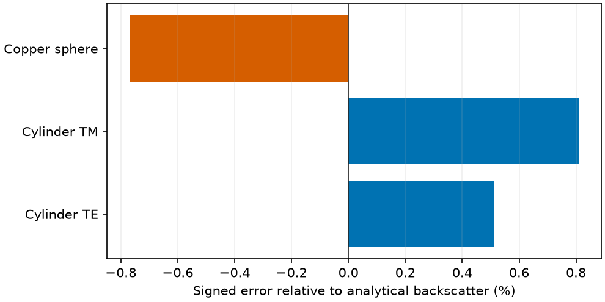

# Automatic-mesh scattering and transmission · published examples

The repository benchmark guide reports backscatter at 3 GHz for a dielectric cylinder (TE and TM) and a 3D copper sphere. Reference values come from the cylindrical-wave series and the impedance-sphere Mie solution. The bars use the rounded published numbers.

| Case | Units | FEM | Reference | Signed error (%) |
| --- | --- | --- | --- | --- |
| Cylinder TE | m | 0.001575 | 0.001567 | 0.511 |
| Cylinder TM | m | 0.005729 | 0.005683 | 0.809 |
| Copper sphere | m² | 0.002451 | 0.00247 | -0.769 |



In the original run both cylinder polarizations met the estimator threshold on the initial mesh. The dielectric-filled through-guide example reported maximum complex S21 error 0.000383 over five frequencies from 7 to 9 GHz. The original summary omits per-frequency samples and the solver commit. These figures are retained as historical reference values.

[Published results](https://github.com/SolverNotConverging/FEM/blob/main/benchmarks/README.md) · [Plotted values](data/automatic_scattering_archive.csv) · [Current cylinder AMR measurements](inclusion.md) · [Current two-port AMR measurements](multiport.md)

[Benchmark index](README.md)

## Run the current examples

```sh
python examples/scattering/2d_dielectric_cylinder.py
python examples/scattering/3d_copper_sphere.py
python examples/antenna/through_waveguide.py
```
