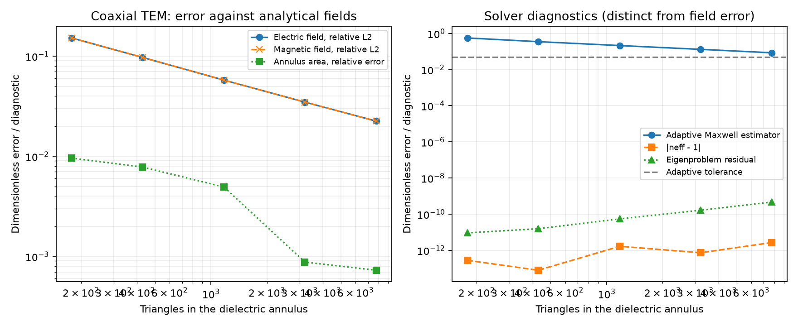
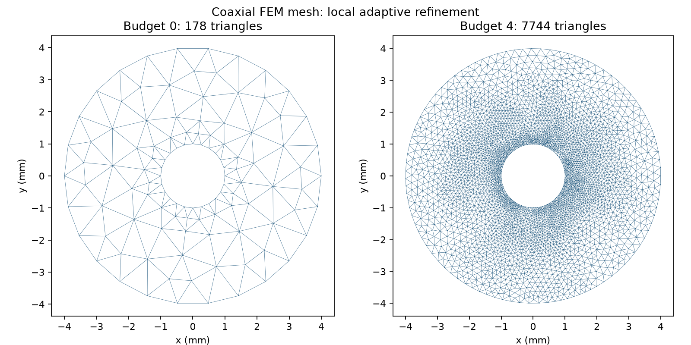

# Coaxial TEM field convergence

A 1 GHz vacuum coax has PEC walls of radius 1 and 4 mm. First-order triangles start at a nominal 1 mm. The exact TEM index is 1 and both fields vary as 1/r. The comparison integrates full-vector L² error on the numerical triangles after phase alignment. Both solutions carry 1 W.

**Passed.** Four passes reduced electric-field error from 15.2% to 2.25%. The estimator was still 0.0851 against its 0.05 tolerance. In a separate matched-target run, local and uniform refinement both crossed 5% field error after three passes: local used 6,260 reduced DOFs and uniform used 7,176. The October run ended at 4.66% field error on 3,178 triangles, starting from a different initial mesh.

| Budget | Triangles | Reduced DOFs | E error (%) | H error (%) | Estimator | Power (W) | Time (s) |
| --- | --- | --- | --- | --- | --- | --- | --- |
| 0 | 178 | 306 | 15.21 | 15.21 | 0.563 | 1.000 | 0.189 |
| 1 | 429 | 805 | 9.717 | 9.717 | 0.35 | 1.000 | 0.186 |
| 2 | 1,178 | 2,286 | 5.762 | 5.762 | 0.213 | 1.000 | 0.4 |
| 3 | 3,204 | 6,260 | 3.478 | 3.478 | 0.131 | 1.000 | 1.36 |
| 4 | 7,744 | 15,288 | 2.247 | 2.247 | 0.0851 | 1.000 | 4.2 |



[Current data](data/coaxial_waveguide_adaptivity/comparison.csv) · [October reference](../../benchmarks/reference_results/coaxial_waveguide_adaptivity/comparison.csv) · [Adaptive history](data/coaxial_waveguide_adaptivity/adaptive_history.csv) · [Matched-target results](data/coaxial_waveguide_adaptivity/field_target.csv)



The matched-target command adds `--field-target .05` to the command below.

## Reproduce

```sh
python benchmarks/analytical/coaxial_waveguide_adaptivity.py --check --output results
```

[Benchmark index](README.md)
