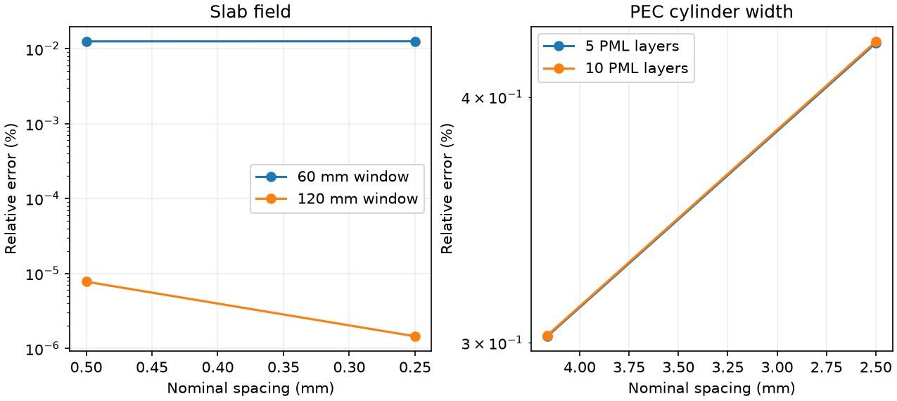

# Controls for the two failed refinement checks

The joint validation suite measures the dielectric slab against an infinite-cladding solution and PEC-cylinder scattering against a cylindrical-wave series. Two additional CPU experiments keep those definitions and vary one boundary setting in each problem. The original gate results remain in the validation report.

| Observable | Boundary control | Nominal level | Relative error (%) |
| --- | --- | --- | --- |
| Slab field | 60 mm window | 120 | 0.012558 |
| Slab field | 60 mm window | 240 | 0.012576 |
| Slab field | 120 mm window | 240 | 0.0000077784 |
| Slab field | 120 mm window | 480 | 0.0000014526 |
| PEC cylinder width | 5 PML layers | 24 | 0.30229 |
| PEC cylinder width | 5 PML layers | 40 | 0.42623 |
| PEC cylinder width | 10 PML layers | 24 | 0.30266 |
| PEC cylinder width | 10 PML layers | 40 | 0.42696 |



**Slab.** Doubling the transverse window from 60 to 120 mm at approximately the same mesh spacing lowered the fine field error from 1.26 × 10⁻⁴ to 1.45 × 10⁻⁸. Within the wider window, halving the spacing reduced the error by a factor of 5.36. This points to finite-window truncation as the dominant error in the original field comparison.

**PEC cylinder.** Doubling the shell from five to ten PML layers changed the fine angular-width error only from 0.4262% to 0.4270%. At both shell resolutions the finer physical target gave the larger error. This experiment rules out layer count alone as the explanation at these settings. It does not identify the cause of the nonmonotonicity.

[Measured rows](data/convergence_controls/comparison.csv) · [Original failed convergence checks](cross_solver_validation.md#failed-convergence-checks)

## Reproduce

```sh
python benchmarks/analytical/convergence_controls.py --output results
```

[Benchmark index](README.md)
