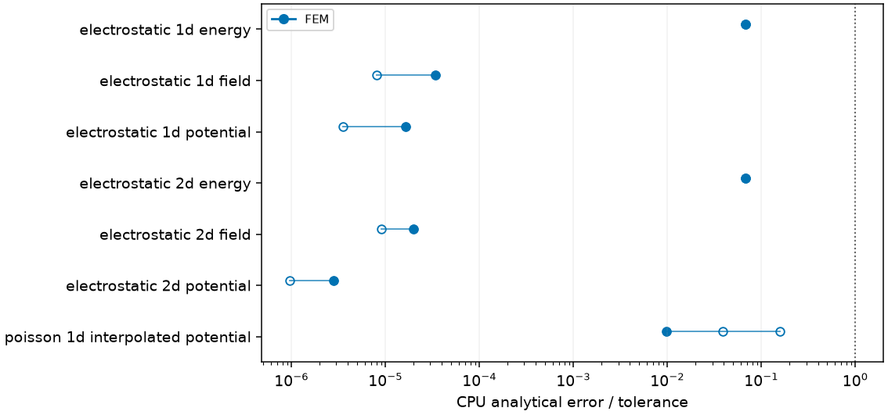
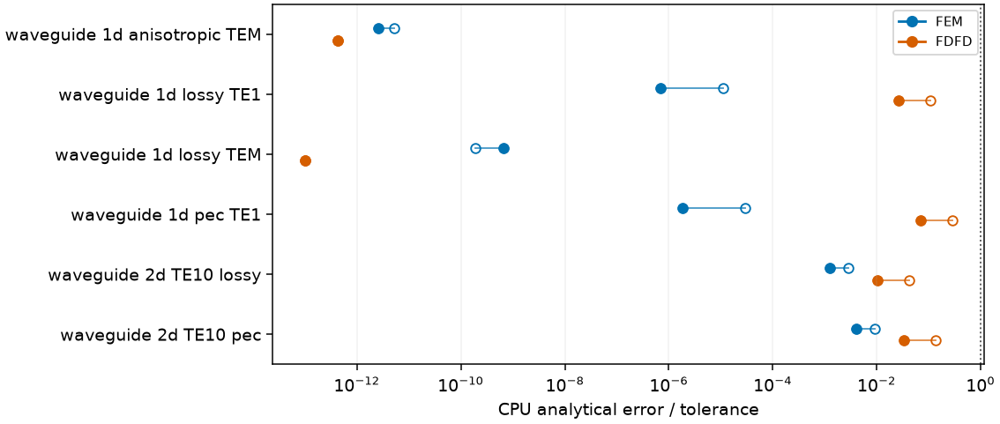
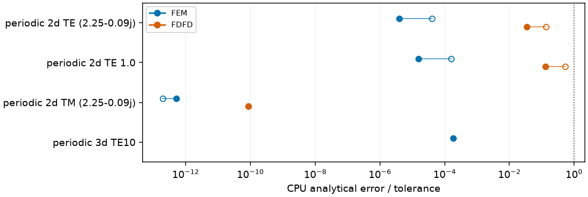
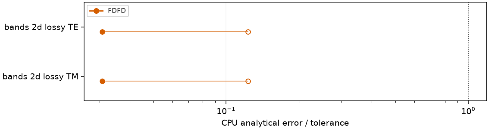
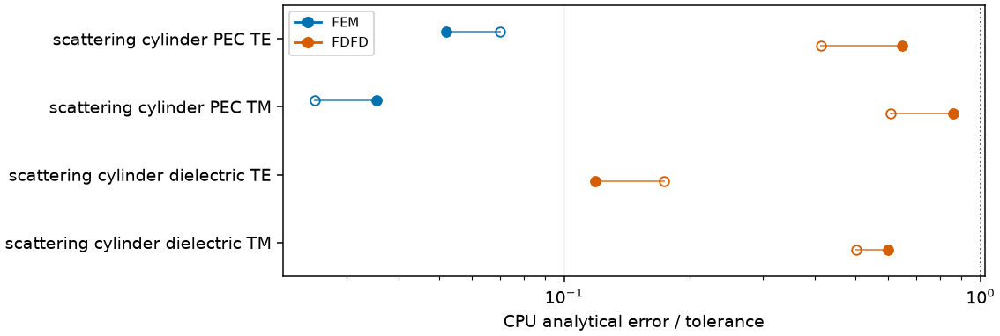
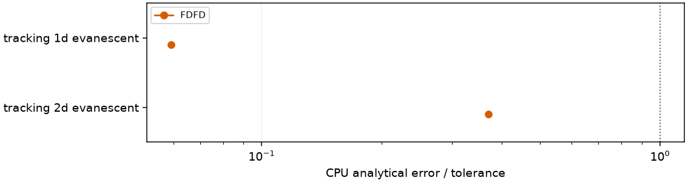
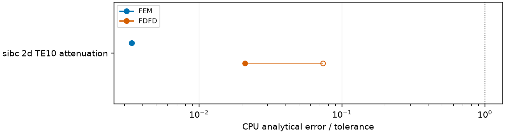
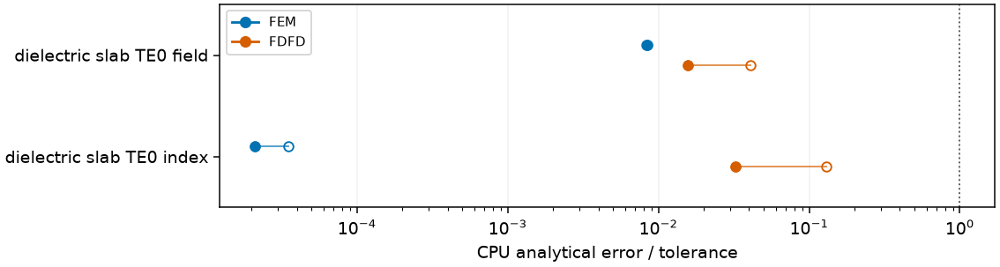

# FEM and FDFD analytical validation

The November run completed all **164 analytical measurements** with zero tolerance failures or solver exceptions. **245 of 247 additional checks passed**. Two FEM mesh-convergence checks failed, so the validation command exited with status 1. All 82 paired CPU/GPU agreement checks passed.

| Additional check | Passed | Total |
| --- | --- | --- |
| residual | 74 | 74 |
| attenuation | 40 | 40 |
| divergence_residual | 8 | 8 |
| gauss_residual | 2 | 2 |
| cpu_gpu_agreement | 82 | 82 |
| family_coverage | 18 | 18 |
| mesh_or_order_convergence | 21 | 23 |

Each row below uses the benchmark’s original error metric and tolerance. Relative error is the Euclidean error norm divided by the reference norm. The gate also tests whether the finest CPU level improves on the coarsest for eligible cases. The plots show analytical error divided by the applicable tolerance; the vertical line is the acceptance threshold.

[All 164 rows](data/cross_solver/measurements.csv) · [247 checks](data/cross_solver/checks.json) · [Raw complex samples and references, gzip](data/cross_solver/results.json.gz) · [Numerical definitions](../../benchmarks/analytical/cross_solver_validation.py)

## Failed convergence checks

A [controlled rerun](convergence_controls.md) tests sensitivity to slab window width and cylinder PML layer count.

- **dielectric_slab_TE0_field** (FEM). From level 120 to 240, error rose from 0.0001256 to 0.0001258 (1.0014×), both within the 0.015 limit.

- **scattering_cylinder_PEC_TM** (FEM). From level 24 to 40, error rose from 0.003023 to 0.004262 (1.4100×), both within the 0.12 limit.

## Static potential, field and energy

Unit-length dielectric capacitors are checked against linear potential, uniform field and stored energy. The grounded Poisson case linearly interpolates nodal voltages at 2,001 locations and compares them with the exact parabola.



| Case | Solver | Level | Metric | CPU error | GPU error | Tolerance |
| --- | --- | --- | --- | --- | --- | --- |
| electrostatic_1d_energy | FEM | 8 | relative | 6.776e-10 | 6.776e-10 | 1e-08 |
| electrostatic_1d_energy | FEM | 16 | relative | 6.776e-10 | 6.776e-10 | 1e-08 |
| electrostatic_1d_field | FEM | 8 | relative | 8.04e-15 | 0 | 1e-09 |
| electrostatic_1d_field | FEM | 16 | relative | 3.413e-14 | 0 | 1e-09 |
| electrostatic_1d_potential | FEM | 8 | relative | 3.525e-15 | 0 | 1e-09 |
| electrostatic_1d_potential | FEM | 16 | relative | 1.654e-14 | 0 | 1e-09 |
| electrostatic_2d_energy | FEM | 8 | relative | 6.776e-10 | 6.776e-10 | 1e-08 |
| electrostatic_2d_energy | FEM | 16 | relative | 6.776e-10 | 6.776e-10 | 1e-08 |
| electrostatic_2d_field | FEM | 8 | relative | 9.006e-15 | 1.013e-14 | 1e-09 |
| electrostatic_2d_field | FEM | 16 | relative | 1.972e-14 | 2.207e-14 | 1e-09 |
| electrostatic_2d_potential | FEM | 8 | relative | 9.556e-16 | 9.903e-16 | 1e-09 |
| electrostatic_2d_potential | FEM | 16 | relative | 2.824e-15 | 4.167e-15 | 1e-09 |
| poisson_1d_interpolated_potential | FEM | 8 | relative | 0.003906 | 0.003906 | 0.025 |
| poisson_1d_interpolated_potential | FEM | 16 | relative | 0.0009766 | 0.0009766 | 0.025 |
| poisson_1d_interpolated_potential | FEM | 32 | relative | 0.0002441 | 0.0002441 | 0.025 |

## Homogeneous waveguide modes

The 1D plate guide tests TE cutoff, loss, TEM propagation and diagonal anisotropy at 30 GHz. The 2D rectangular guide tests the TE₁₀ cutoff relation with lossless and lossy filling. Comparisons use the complex effective index.



| Case | Solver | Level | Metric | CPU error | GPU error | Tolerance |
| --- | --- | --- | --- | --- | --- | --- |
| waveguide_1d_anisotropic_TEM | FDFD | 40 | relative | 1.282e-16 | 1.282e-16 | 0.0003 |
| waveguide_1d_anisotropic_TEM | FDFD | 80 | relative | 1.282e-16 | 0 | 0.0003 |
| waveguide_1d_anisotropic_TEM | FEM | 40 | relative | 1.538e-15 | 8.974e-16 | 0.0003 |
| waveguide_1d_anisotropic_TEM | FEM | 80 | relative | 7.692e-16 | 2.692e-15 | 0.0003 |
| waveguide_1d_lossy_TE1 | FDFD | 40 | relative | 3.204e-05 | 3.204e-05 | 0.0003 |
| waveguide_1d_lossy_TE1 | FDFD | 80 | relative | 8.011e-06 | 8.011e-06 | 0.0003 |
| waveguide_1d_lossy_TE1 | FEM | 40 | relative | 3.293e-09 | 3.293e-09 | 0.0003 |
| waveguide_1d_lossy_TE1 | FEM | 80 | relative | 2.058e-10 | 2.058e-10 | 0.0003 |
| waveguide_1d_lossy_TEM | FDFD | 40 | relative | 3.006e-17 | 1.037e-15 | 0.0003 |
| waveguide_1d_lossy_TEM | FDFD | 80 | relative | 3.006e-17 | 7.695e-15 | 0.0003 |
| waveguide_1d_lossy_TEM | FEM | 40 | relative | 5.742e-14 | 4.554e-15 | 0.0003 |
| waveguide_1d_lossy_TEM | FEM | 80 | relative | 1.988e-13 | 5.536e-14 | 0.0003 |
| waveguide_1d_pec_TE1 | FDFD | 40 | relative | 8.549e-05 | 8.549e-05 | 0.0003 |
| waveguide_1d_pec_TE1 | FDFD | 80 | relative | 2.138e-05 | 2.138e-05 | 0.0003 |
| waveguide_1d_pec_TE1 | FEM | 40 | relative | 8.789e-09 | 8.789e-09 | 0.0003 |
| waveguide_1d_pec_TE1 | FEM | 80 | relative | 5.493e-10 | 5.491e-10 | 0.0003 |
| waveguide_2d_TE10_lossy | FDFD | 24 | relative | 0.0001683 | 0.0001683 | 0.004 |
| waveguide_2d_TE10_lossy | FDFD | 48 | relative | 4.211e-05 | 4.211e-05 | 0.004 |
| waveguide_2d_TE10_lossy | FEM | 12 | relative | 1.138e-05 | 1.138e-05 | 0.004 |
| waveguide_2d_TE10_lossy | FEM | 24 | relative | 5.034e-06 | 5.034e-06 | 0.004 |
| waveguide_2d_TE10_pec | FDFD | 24 | relative | 0.0005381 | 0.0005381 | 0.004 |
| waveguide_2d_TE10_pec | FDFD | 48 | relative | 0.0001346 | 0.0001346 | 0.004 |
| waveguide_2d_TE10_pec | FEM | 12 | relative | 3.638e-05 | 3.638e-05 | 0.004 |
| waveguide_2d_TE10_pec | FEM | 24 | relative | 1.609e-05 | 1.609e-05 | 0.004 |

## Periodic waveguides

Homogeneous cells use analytical cutoff and material index for Bloch propagation. The suite tests TE and TM in 2D and a separate FEM tetrahedral TE₁₀ cell.



| Case | Solver | Level | Metric | CPU error | GPU error | Tolerance |
| --- | --- | --- | --- | --- | --- | --- |
| periodic_2d_TE_(2.25-0.09j) | FDFD | 12 | relative | 0.0009462 | 0.0009462 | 0.007 |
| periodic_2d_TE_(2.25-0.09j) | FDFD | 24 | relative | 0.000237 | 0.000237 | 0.007 |
| periodic_2d_TE_(2.25-0.09j) | FEM | 12 | relative | 2.87e-07 | 2.87e-07 | 0.007 |
| periodic_2d_TE_(2.25-0.09j) | FEM | 24 | relative | 2.757e-08 | 2.757e-08 | 0.007 |
| periodic_2d_TE_1.0 | FDFD | 12 | relative | 0.003645 | 0.003645 | 0.007 |
| periodic_2d_TE_1.0 | FDFD | 24 | relative | 0.0009141 | 0.0009141 | 0.007 |
| periodic_2d_TE_1.0 | FEM | 12 | relative | 1.108e-06 | 1.108e-06 | 0.007 |
| periodic_2d_TE_1.0 | FEM | 24 | relative | 1.064e-07 | 1.064e-07 | 0.007 |
| periodic_2d_TM_(2.25-0.09j) | FDFD | 12 | relative | 5.969e-13 | 5.967e-13 | 0.007 |
| periodic_2d_TM_(2.25-0.09j) | FDFD | 24 | relative | 5.985e-13 | 5.964e-13 | 0.007 |
| periodic_2d_TM_(2.25-0.09j) | FEM | 12 | relative | 1.335e-15 | 8.899e-16 | 0.007 |
| periodic_2d_TM_(2.25-0.09j) | FEM | 24 | relative | 3.551e-15 | 1.924e-15 | 0.007 |
| periodic_3d_TE10 | FEM | 1 | relative | 1.86e-06 | 1.86e-06 | 0.01 |

## Lossy bands

FDFD computes the complex frequency at prescribed Bloch wavevector for a uniform lossy medium. Both polarizations are compared with c|β|/(2π√(εᵣμᵣ)).



| Case | Solver | Level | Metric | CPU error | GPU error | Tolerance |
| --- | --- | --- | --- | --- | --- | --- |
| bands_2d_lossy_TE | FDFD | 12 | relative | 0.0001233 | 0.0001233 | 0.001 |
| bands_2d_lossy_TE | FDFD | 24 | relative | 3.082e-05 | 3.082e-05 | 0.001 |
| bands_2d_lossy_TM | FDFD | 12 | relative | 0.0001233 | 0.0001233 | 0.001 |
| bands_2d_lossy_TM | FDFD | 24 | relative | 3.082e-05 | 3.082e-05 | 0.001 |

## Angular scattering and exterior fields

A 3 GHz wave illuminates a 25 mm radius cylinder. FEM evaluates PEC scattering width in 31 directions. FDFD compares complex field samples on an exterior annulus against PEC and dielectric cylindrical-wave expansions. The two packages therefore test different observables in this group.



| Case | Solver | Level | Metric | CPU error | GPU error | Tolerance |
| --- | --- | --- | --- | --- | --- | --- |
| scattering_cylinder_PEC_TE | FDFD | 120 | relative | 0.03304 | 0.03304 | 0.08 |
| scattering_cylinder_PEC_TE | FDFD | 240 | relative | 0.01941 | 0.01941 | 0.03 |
| scattering_cylinder_PEC_TE | FEM | 24 | relative | 0.008408 | 0.008408 | 0.12 |
| scattering_cylinder_PEC_TE | FEM | 40 | relative | 0.006251 | 0.006251 | 0.12 |
| scattering_cylinder_PEC_TM | FDFD | 120 | relative | 0.04877 | 0.04877 | 0.08 |
| scattering_cylinder_PEC_TM | FDFD | 240 | relative | 0.0258 | 0.0258 | 0.03 |
| scattering_cylinder_PEC_TM | FEM | 24 | relative | 0.003023 | 0.003023 | 0.12 |
| scattering_cylinder_PEC_TM | FEM | 40 | relative | 0.004262 | 0.004262 | 0.12 |
| scattering_cylinder_dielectric_TE | FDFD | 120 | relative | 0.01394 | 0.01394 | 0.08 |
| scattering_cylinder_dielectric_TE | FDFD | 240 | relative | 0.003561 | 0.003561 | 0.03 |
| scattering_cylinder_dielectric_TM | FDFD | 120 | relative | 0.04016 | 0.04016 | 0.08 |
| scattering_cylinder_dielectric_TM | FDFD | 240 | relative | 0.01799 | 0.01799 | 0.03 |

## Evanescent-mode tracking

FDFD follows the below-cutoff mode at 0.8 and 0.9 times the cutoff frequency in one and two dimensions. The reference is the negative-imaginary effective index of the evanescent guide mode.



| Case | Solver | Level | Metric | CPU error | GPU error | Tolerance |
| --- | --- | --- | --- | --- | --- | --- |
| tracking_1d_evanescent | FDFD | 80 | relative | 0.000237 | 0.000237 | 0.004 |
| tracking_2d_evanescent | FDFD | 32 | relative | 0.001482 | 0.001482 | 0.004 |

## Wall-loss attenuation

Attenuation of the copper-walled guide is compared with the first-order wall-loss perturbation for rectangular TE₁₀ at 10 GHz. The reference itself is an approximation.



| Case | Solver | Level | Metric | CPU error | GPU error | Tolerance |
| --- | --- | --- | --- | --- | --- | --- |
| sibc_2d_TE10_attenuation | FDFD | 24 | relative | 0.002213 | 0.002213 | 0.03 |
| sibc_2d_TE10_attenuation | FDFD | 48 | relative | 0.0006306 | 0.0006306 | 0.03 |
| sibc_2d_TE10_attenuation | FEM | 24 | relative | 0.0001013 | 0.0001013 | 0.03 |
| sibc_2d_TE10_attenuation | FEM | 48 | relative | 0.0001018 | 0.0001018 | 0.03 |

## Dielectric slab mode

The index comes from the even TE₀ dispersion root of a symmetric step-index slab. Field samples are compared with a cosine in the core and an exponential tail after fitting a single complex amplitude. The core half-width is 5 mm, the window is 60 mm and the frequency is 10 GHz.



| Case | Solver | Level | Metric | CPU error | GPU error | Tolerance |
| --- | --- | --- | --- | --- | --- | --- |
| dielectric_slab_TE0_field | FDFD | 120 | relative | 0.0006115 | 0.0006115 | 0.015 |
| dielectric_slab_TE0_field | FDFD | 240 | relative | 0.0002365 | 0.0002365 | 0.015 |
| dielectric_slab_TE0_field | FEM | 120 | relative | 0.0001256 | 0.0001256 | 0.015 |
| dielectric_slab_TE0_field | FEM | 240 | relative | 0.0001258 | 0.0001258 | 0.015 |
| dielectric_slab_TE0_index | FDFD | 120 | relative | 0.0002588 | 0.0002588 | 0.002 |
| dielectric_slab_TE0_index | FDFD | 240 | relative | 6.489e-05 | 6.489e-05 | 0.002 |
| dielectric_slab_TE0_index | FEM | 120 | relative | 7.048e-08 | 7.048e-08 | 0.002 |
| dielectric_slab_TE0_index | FEM | 240 | relative | 4.225e-08 | 4.225e-08 | 0.002 |

## Reproduce

Use the FEM environment with CUDA and a sibling FDFD checkout. These measurements used FDFD revision `432878e`. FDFD periodic 3D is outside the joint driver’s defined coverage.

```sh
python benchmarks/analytical/cross_solver_validation.py
```

[Benchmark index](README.md)
