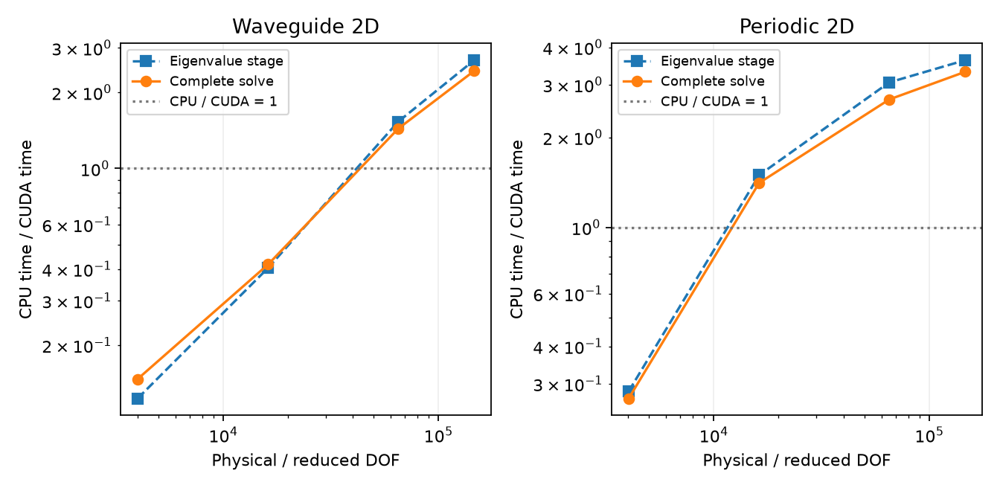

# CUDA versus SciPy · October reference

The October 16 reference compared FEM `29609315da77` and FDFD `ca2d5f442847` on an RTX 4070 Laptop (8 GB) and i9-13900H. Each mesh requested one forward mode at tolerance 10⁻⁹. Three alternating CPU/GPU pairs followed per-case warmup; both backends refactorized on every call. The tables report warm complete-solve medians. The eigenvalue-stage timings and cold starts are in the source data.

The complete solve includes physical filters, reconstruction, normalization and error estimation; it excludes meshing. Differences in field-space dimension, arithmetic and solver work matter when comparing families. CPU/GPU greater than one means the GPU had the shorter warm solve.

| Solver | Family | Case | DOFs | CPU (s) | GPU (s) | CPU / GPU |
| --- | --- | --- | --- | --- | --- | --- |
| FEM | waveguide_2d | pec | 6,447 | 0.4242 | 1.391 | 0.305× |
| FEM | waveguide_2d | pec | 25,099 | 1.966 | 1.922 | 1.02× |
| FEM | waveguide_2d | pec | 68,827 | 6.719 | 3.785 | 1.78× |
| FEM | waveguide_2d | pec | 176,051 | 19.99 | 8.338 | 2.4× |
| FEM | waveguide_2d | pec_lossy | 25,099 | 2.483 | 2.091 | 1.19× |
| FEM | waveguide_2d | pec_lossy | 68,827 | 8.029 | 3.665 | 2.19× |
| FEM | waveguide_2d | pec_sibc_lossy | 24,270 | 1.974 | 2.079 | 0.95× |
| FEM | waveguide_2d | pec_sibc_lossy | 66,766 | 6.448 | 3.599 | 1.79× |
| FEM | periodic_2d | pec | 1,428 | 0.1089 | 0.5187 | 0.21× |
| FEM | periodic_2d | pec | 5,506 | 0.522 | 0.8199 | 0.637× |
| FEM | periodic_2d | pec | 15,083 | 2.013 | 2.301 | 0.875× |
| FEM | periodic_2d | pec | 59,701 | 12.36 | 11.45 | 1.08× |
| FEM | periodic_2d | pec | 152,058 | 52.12 | 46.48 | 1.12× |
| FEM | periodic_2d | dielectric_insert | 74,585 | 16.47 | 14.96 | 1.1× |
| FEM | periodic_2d | pec_lossy | 5,506 | 0.5112 | 0.8249 | 0.62× |
| FEM | periodic_2d | pec_lossy | 15,083 | 2.01 | 2.226 | 0.903× |
| FEM | periodic_3d | iris_pec | 8,774 | 3.019 | 0.715 | 4.22× |
| FEM | periodic_3d | iris_pec | 31,353 | 21.74 | 1.851 | 11.7× |
| FEM | periodic_3d | iris_pec | 82,081 | 151.9 | 3.24 | 46.9× |
| FEM | periodic_3d | iris_lossy | 31,353 | 21.54 | 2.158 | 9.98× |

[Raw measurements](../_static/benchmarks/cuda_vs_scipy_20261016/results.json) · [CSV](../_static/benchmarks/cuda_vs_scipy_20261016/summary.csv) · [Original methods and reproduction](cuda_vs_scipy.rst)

The FEM table above covers 20 configurations. The sibling FDFD archive records 13 configurations and 78 warm samples on the same machine. Its maximum relative CPU/GPU index difference was 4.14 × 10⁻¹². [FDFD timings](data/fdfd_cuda_archive/summary.csv) · [FDFD verification](data/fdfd_cuda_archive/verification.json)

[Benchmark index](README.md)
