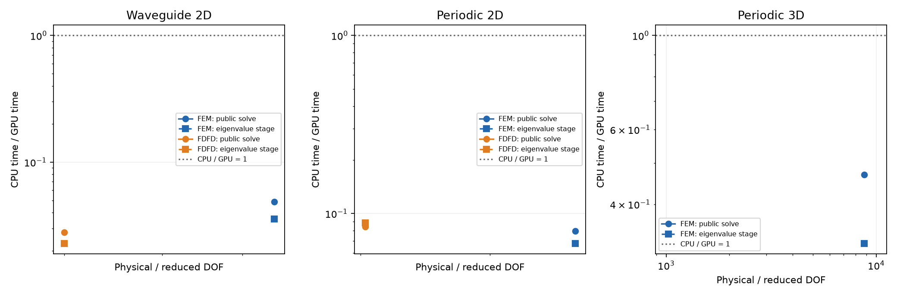

# Paired FEM and FDFD modal timings

Five representative configurations cover all solver families in the October timing suite. FEM revision `6ada998` and sibling FDFD `432878e` used identical per-backend meshes for each configuration, one requested mode, tolerance 10⁻⁹ and three alternating warm repeats after first use. Both refactorize on each solve. FEM periodic 3D uses first-order tetrahedra. Assembly is outside the complete-solve timer. The eigen timer includes factorization and mode extraction.

These 26 November timings were measured on the shared RTX 4070 Laptop. The October full-size sweep used different software and load conditions. Its raw results are linked separately.

| Solver | Family | Case | DOFs | Complete CPU (s) | Complete GPU (s) | Eigen CPU (s) | Eigen GPU (s) | Max relative index difference |
| --- | --- | --- | --- | --- | --- | --- | --- | --- |
| FEM | waveguide_2d | pec | 6,447 | 0.4229 | 8.671 | 0.299 | 8.404 | 5.38e-15 |
| FEM | periodic_2d | pec | 5,792 | 0.263 | 3.304 | 0.2039 | 3.012 | 3.56e-14 |
| FEM | periodic_3d | iris_pec | 8,774 | 1.654 | 3.524 | 1.03 | 3.189 | 7.08e-15 |
| FDFD | waveguide_2d | pec | 4,000 | 0.0252 | 0.9025 | 0.01868 | 0.8214 | 3.49e-14 |
| FDFD | periodic_2d | pec | 4,032 | 0.09909 | 1.178 | 0.09589 | 1.081 | 1.47e-13 |



All five configurations returned paired measurements. Each reported median aggregates three samples per backend. The small configurations in this table cover a limited DOF range; the raw samples show timing dispersion.

[Paired data](data/cuda_vs_scipy/results.json) · [Summary](data/cuda_vs_scipy/summary.csv) · [Environment](data/cuda_vs_scipy/environment.json) · [October timings](cuda_vs_scipy_archive.md)

## Reproduce

```sh
python benchmarks/cuda_vs_scipy.py --repeats 3 --ids FEM_waveguide_2d_pec_48 FEM_periodic_2d_pec_48 FEM_periodic_3d_iris_pec_1.6 FDFD_waveguide_2d_pec_64 FDFD_periodic_2d_pec_64 --output results
python benchmarks/report_cuda_vs_scipy.py results
```

[Benchmark index](README.md)
