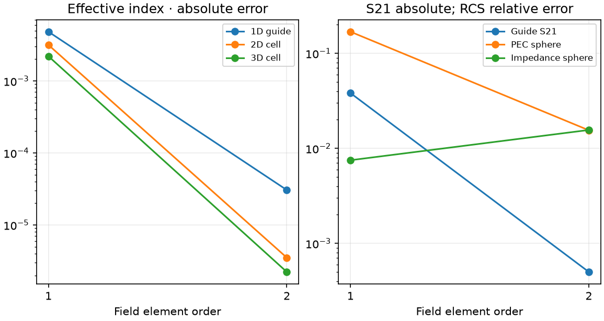

# Field element order · published accuracy checks

These measurements were published in the repository’s benchmark guide. Each pair uses the same physical mesh and absorber with adaptive refinement disabled. The modal cases use a one-metre free-space wavelength and a one-metre broad wall. Exact TE index is √0.75. The 1D and 2D targets are 0.20 m and the 3D target is 0.12 m.

The through-guide is 0.72 m wide and 0.55 m long with h = 0.16 m. The spheres have radius 0.15 m, h = 0.20 m and four PML layers. For the impedance sphere, normalized surface impedance is 0.3 + 0.2i. The sphere runs used 25,331 first-order and 132,856 second-order DOFs including the shell.

| Observable | Error measure | Order 1 | Order 2 |
| --- | --- | --- | --- |
| 1D guide | absolute | 0.00482 | 3.06e-05 |
| 2D cell | absolute | 0.00316 | 3.52e-06 |
| 3D cell | absolute | 0.0022 | 2.23e-06 |
| Guide S21 | absolute | 0.0382 | 0.0005 |
| PEC sphere | relative | 0.1689 | 0.0155 |
| Impedance sphere | relative | 0.0075 | 0.0156 |



Quadratic order reduced propagation and PEC sphere errors on these meshes. The impedance sphere’s error increased from 0.75% to 1.56%. The historical guide also records a PEC patch at 2.50 GHz: reducing the background target from 8 to 6.5 mm moved S11 from −11.60 to −11.39 dB and broadside realized gain from 6.255 to 6.237 dBi. The feed and patch sizing were held fixed.

[Tabulated source](https://github.com/SolverNotConverging/FEM/blob/main/benchmarks/README.md) · [Plotted values](data/element_order_archive.csv) · [Propagation regression](../../tests/test_quadratic_propagation.py) · [Guide regression](../../tests/antenna/test_antenna.py) · [Mie regression](../../tests/test_cuda_solvers.py)

[Benchmark index](README.md)

## Reproduce the numerical checks

Run the propagation and through-guide checks on CPU. The metal-sphere regression requires CUDA and `FEM_TEST_CUDA=1`.

```sh
python -m pytest tests/test_quadratic_propagation.py
python -m pytest tests/antenna/test_antenna.py -k through_guide_against_analytical_transmission
python -m pytest tests/test_cuda_solvers.py -k metal_sphere_cudss_backscatter_against_mie
```
