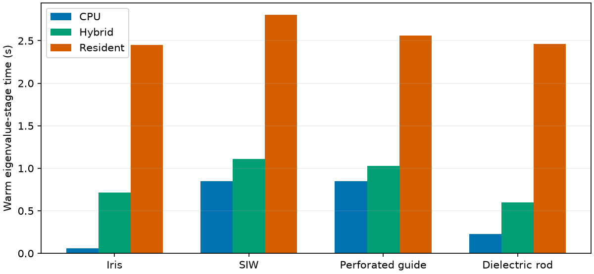

# Four periodic 3D cells · November laptop rerun

The coarse configuration of each archived 3D cell was rebuilt on the current FEM solver. The four cells cover a 12 GHz WR-90 iris and three 20 GHz problems: a via-loaded substrate-integrated waveguide, a perforated guide with PML, and a periodically patched dielectric rod with PML. The comparison pins first-order tetrahedra and records the actual reduced field DOFs.

Each cell uses one assembled quadratic eigenproblem. CPU ARPACK, hybrid CUDA and resident CUDA each compute four roots at ncv = 80, tolerance 10⁻⁸ and seed 0. Assembly and independent host validation are outside the timed eigenvalue stage. There is one warmup per backend and three timed repeats with rotating execution order.

| Cell | h (mm) | Reduced DOFs | CPU (s) | Hybrid (s) | Resident (s) | Max QEP residual |
| --- | --- | --- | --- | --- | --- | --- |
| iris | 4.0 | 1,590 | 0.06029 | 0.7124 | 2.45 | 5.03e-14 |
| siw | 2.0 | 12,127 | 0.8499 | 1.111 | 2.802 | 2.7e-14 |
| perforated_waveguide | 5.0 | 11,775 | 0.8462 | 1.026 | 2.562 | 6.26e-14 |
| dielectric_rod | 4.0 | 2,481 | 0.2258 | 0.5977 | 2.465 | 1.01e-13 |



**Passed.** All 36 timed solves and 12 warmups passed the residual and one-to-one root-magnitude checks. CPU had the shortest median on these four coarse laptop meshes. These shared-load runs sample the smallest target set from the archived suite. The TITAN report covers all original sizes and uses a different host.

[Summary CSV](data/four_cells/summary.csv) · [Eigenvalues, residuals and individual samples](data/four_cells/samples.json.gz) · [Geometry definitions](../../benchmarks/resident_comparison/geometries.py) · [Full TITAN sweep](titan_resident.md)

## Reproduce

```sh
python benchmarks/resident_comparison/run.py --gpu 0 --repeats 3 --case iris-coarse siw-coarse perforated_waveguide-coarse dielectric_rod-coarse --output results
```

[Benchmark index](README.md)
