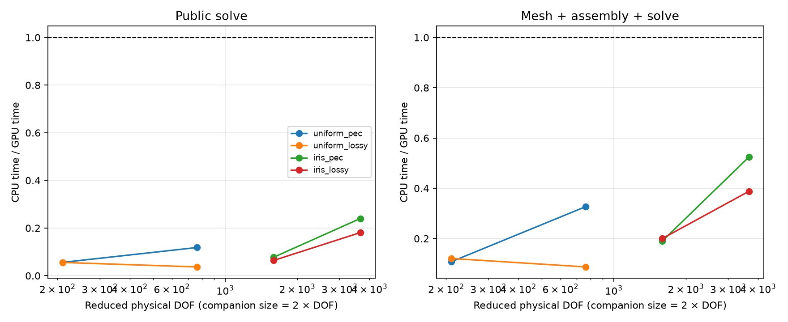

# 3D periodic cells · CPU and resident GPU

A 12 GHz WR-90 guide (22.86 × 10.16 mm) has an 8 mm period. Cases cover empty and iris-loaded guides in vacuum and lossy dielectric (εᵣ = 2 − 0.02i). The iris blocks occupy both side walls over z = 3.6–4.4 mm. Nominal tetrahedral targets are 4 and 2.5 mm. This rerun explicitly pins first-order Nédélec elements to match the published protocol.

Each configuration used a single assembled mesh with AMR off, an untimed warmup per backend, and three alternating pairs of complete sparse solves. Factorizations were rebuilt each time. One CPU BLAS thread was requested. The GPU shared the machine with a separate simulation for part of this sweep; the CSV includes the individual samples.

| Case | Size (mm) | Field DOFs | CPU median (s) | GPU median (s) | CPU / GPU | Max relative index difference |
| --- | --- | --- | --- | --- | --- | --- |
| uniform_pec | 4.0 | 210 | 0.03527 | 0.6305 | 0.0559× | 6.62e-16 |
| uniform_pec | 2.5 | 764 | 0.08433 | 0.7126 | 0.118× | 2.65e-16 |
| uniform_lossy | 4.0 | 210 | 0.03079 | 0.5532 | 0.0557× | 1.85e-16 |
| uniform_lossy | 2.5 | 764 | 0.07517 | 2.038 | 0.0369× | 1.77e-16 |
| iris_pec | 4.0 | 1,595 | 0.1883 | 2.425 | 0.0777× | 9.96e-16 |
| iris_pec | 2.5 | 3,666 | 0.632 | 2.631 | 0.24× | 1.31e-15 |
| iris_lossy | 4.0 | 1,595 | 0.1649 | 2.566 | 0.0642× | 2.39e-16 |
| iris_lossy | 2.5 | 3,666 | 0.475 | 2.623 | 0.181× | 9.15e-16 |



All 8 CPU/GPU comparisons passed the 10⁻⁶ relative-index tolerance. The largest observed difference was 1.31e-15. Speedups below one indicate shorter CPU wall time on these mesh sizes. These samples do not establish a large-mesh crossover.

[Per-repeat samples](data/gpu_periodic_3d/samples.csv) · [Full summary](data/gpu_periodic_3d/summary.csv) · [Environment](data/gpu_periodic_3d/environment.json)

## Reproduce

```sh
python benchmarks/gpu_periodic_3d.py --sizes-mm 4 2.5 --repeats 3 --output results
```

[Benchmark index](README.md)
