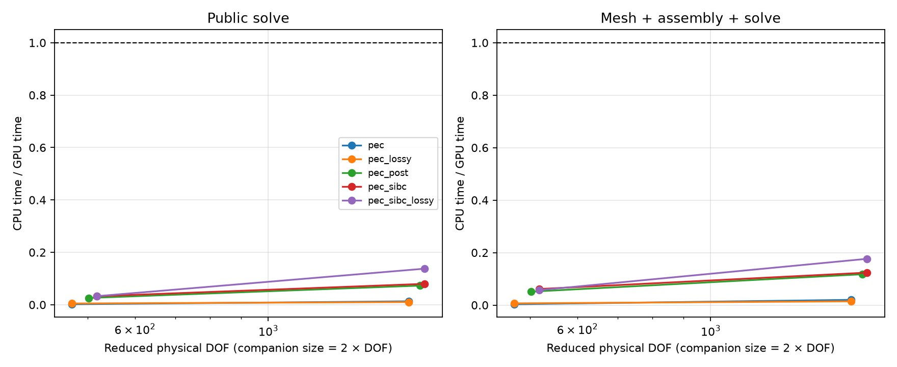

# 2D waveguide · CPU and resident GPU

A 1 × 0.5 m PEC enclosure at 299.792458 MHz contains vacuum, dielectric εᵣ = 2 − 0.02i, a PEC post or a surface-impedance post (20 + 20i Ω). Posts occupy x = 0.56–0.68 m, y = 0.11–0.23 m. Five cases use first-order meshes and one requested mode at nominal resolutions 12 and 24.

Each configuration used a single assembled mesh with AMR off, an untimed warmup per backend, and three alternating pairs of complete sparse solves. Factorizations were rebuilt each time. One CPU BLAS thread was requested. The GPU shared the machine with a separate simulation for part of this sweep; the CSV includes the individual samples.

| Case | Resolution | Field DOFs | CPU median (s) | GPU median (s) | CPU / GPU | Max relative index difference |
| --- | --- | --- | --- | --- | --- | --- |
| pec | 12 | 471 | 0.02889 | 14.66 | 0.00197× | 1.28e-16 |
| pec | 24 | 1,715 | 0.0869 | 6.681 | 0.013× | 7.69e-16 |
| pec_lossy | 12 | 471 | 0.05313 | 10.99 | 0.00484× | 1.68e-16 |
| pec_lossy | 24 | 1,715 | 0.1159 | 11.35 | 0.0102× | 1.68e-16 |
| pec_post | 12 | 502 | 0.03571 | 1.383 | 0.0258× | 8.8e-16 |
| pec_post | 24 | 1,790 | 0.1013 | 1.388 | 0.073× | 1.01e-15 |
| pec_sibc | 12 | 518 | 0.04419 | 1.362 | 0.0324× | 1.29e-16 |
| pec_sibc | 24 | 1,822 | 0.1121 | 1.404 | 0.0798× | 5.52e-16 |
| pec_sibc_lossy | 12 | 518 | 0.04429 | 1.356 | 0.0327× | 1.78e-16 |
| pec_sibc_lossy | 24 | 1,822 | 0.2449 | 1.779 | 0.138× | 3.62e-16 |



All 10 CPU/GPU comparisons passed the 10⁻⁶ relative-index tolerance. The largest observed difference was 1.01e-15. Speedups below one indicate shorter CPU wall time on these mesh sizes. These samples do not establish a large-mesh crossover.

[Per-repeat samples](data/gpu_waveguide_2d/samples.csv) · [Full summary](data/gpu_waveguide_2d/summary.csv) · [Environment](data/gpu_waveguide_2d/environment.json)

## Reproduce

```sh
python benchmarks/gpu_waveguide_2d.py --levels 12 24 --repeats 3 --output results
```

[Benchmark index](README.md)
