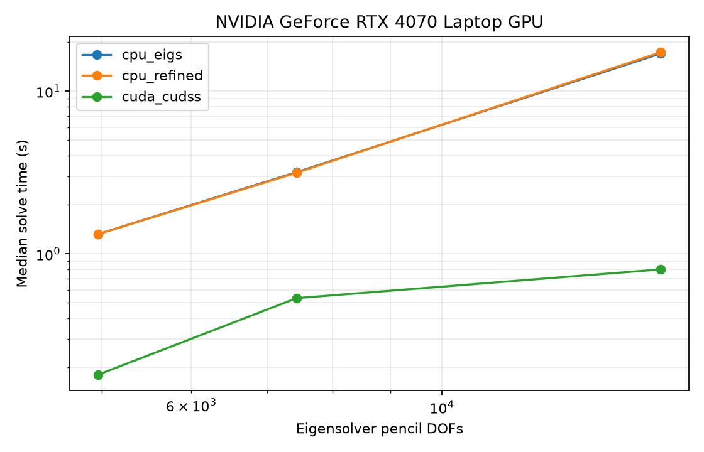

# Historical antenna pencil · RTX 4070 Laptop

Measured on 13 October 2026. A 3D periodic dielectric-rod antenna generates a generalized companion eigenproblem. The older solver factors the full companion pencil. The FEM field count is half the pencil dimension. Four eigenpairs were requested at original-pencil tolerance 10⁻⁸, with ncv = 80, complex FP64 arithmetic and one CPU BLAS thread. Times are medians of three warm solves. Assembly was excluded; GPU transfers and cuDSS factorization were included.

| Size | Field DOFs | Pencil DOFs | Backend | Median (s) | Max residual | Speedup vs CPU eigs |
| --- | --- | --- | --- | --- | --- | --- |
| 4.0 | 2,481 | 4,962 | cpu_eigs | 1.323 | 2.75e-14 | 1.00× |
| 4.0 | 2,481 | 4,962 | cpu_refined | 1.321 | 2.88e-14 | 1.00× |
| 4.0 | 2,481 | 4,962 | cuda_cudss | 0.1806 | 1.46e-13 | 7.32× |
| 3.0 | 3,720 | 7,440 | cpu_eigs | 3.181 | 3.39e-14 | 1.00× |
| 3.0 | 3,720 | 7,440 | cpu_refined | 3.156 | 4.02e-14 | 1.01× |
| 3.0 | 3,720 | 7,440 | cuda_cudss | 0.5341 | 2.69e-13 | 5.96× |
| 2.0 | 7,814 | 15,628 | cpu_eigs | 17.07 | 5.09e-14 | 1.00× |
| 2.0 | 7,814 | 15,628 | cpu_refined | 17.37 | 5.2e-14 | 0.983× |
| 2.0 | 7,814 | 15,628 | cuda_cudss | 0.8018 | 5.34e-13 | 21.3× |



The plotted and tabulated artifacts were recovered byte-for-byte from revision `3402f85`. These timings describe the October implementation and host state. The current public-solve and resident-estimator benchmarks include different work.

[Archived CSV](data/historical_antenna/results.csv) · [Original report](https://github.com/SolverNotConverging/FEM/tree/3402f85/benchmarks/reference_results/cuda_laptop_antenna) · [Reproduction driver](../../benchmarks/reproduce_historical_gpu.py)

## Reproduce

```sh
python benchmarks/reproduce_historical_gpu.py --phase exact-antenna --revision 3402f85 --repeats 3
```

[Benchmark index](README.md)
