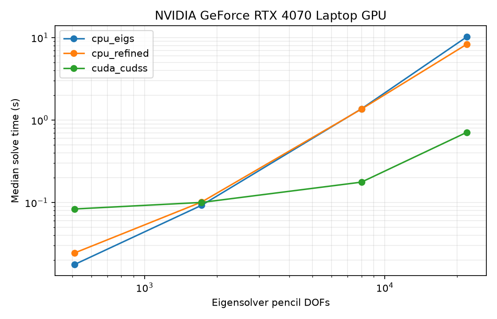

# Historical stencil pencil · RTX 4070 Laptop

Measured on 13 October 2026. A 3D complex nonsymmetric stencil with nonidentity mass matrix isolates sparse eigensolver scaling on a controlled pencil. Four eigenpairs were requested at original-pencil tolerance 10⁻⁸, with ncv = 64, complex FP64 arithmetic and one CPU BLAS thread. Times are medians of three warm solves. Assembly was excluded; GPU transfers and cuDSS factorization were included.

| Size | Field DOFs | Pencil DOFs | Backend | Median (s) | Max residual | Speedup vs CPU eigs |
| --- | --- | --- | --- | --- | --- | --- |
| 8 | 512 | 512 | cpu_eigs | 0.01777 | 9.97e-15 | 1.00× |
| 8 | 512 | 512 | cpu_refined | 0.02451 | 3.29e-15 | 0.725× |
| 8 | 512 | 512 | cuda_cudss | 0.08358 | 3.23e-15 | 0.213× |
| 12 | 1,728 | 1,728 | cpu_eigs | 0.09263 | 7.81e-15 | 1.00× |
| 12 | 1,728 | 1,728 | cpu_refined | 0.1015 | 4.64e-15 | 0.913× |
| 12 | 1,728 | 1,728 | cuda_cudss | 0.1003 | 5.77e-15 | 0.924× |
| 20 | 8,000 | 8,000 | cpu_eigs | 1.369 | 2.46e-14 | 1.00× |
| 20 | 8,000 | 8,000 | cpu_refined | 1.359 | 1.05e-14 | 1.01× |
| 20 | 8,000 | 8,000 | cuda_cudss | 0.1768 | 9.85e-15 | 7.74× |
| 28 | 21,952 | 21,952 | cpu_eigs | 10.19 | 2.51e-14 | 1.00× |
| 28 | 21,952 | 21,952 | cpu_refined | 8.297 | 1.34e-14 | 1.23× |
| 28 | 21,952 | 21,952 | cuda_cudss | 0.7096 | 1.39e-14 | 14.4× |



The plotted and tabulated artifacts were recovered byte-for-byte from revision `3402f85`. These timings describe the October implementation and host state. The current public-solve and resident-estimator benchmarks include different work.

[Archived CSV](data/historical_stencil/results.csv) · [Original report](https://github.com/SolverNotConverging/FEM/tree/3402f85/benchmarks/reference_results/cuda_laptop_stencil) · [Reproduction driver](../../benchmarks/reproduce_historical_gpu.py)

## Reproduce

```sh
python benchmarks/reproduce_historical_gpu.py --phase exact-stencil --revision 3402f85 --repeats 3
```

[Benchmark index](README.md)
