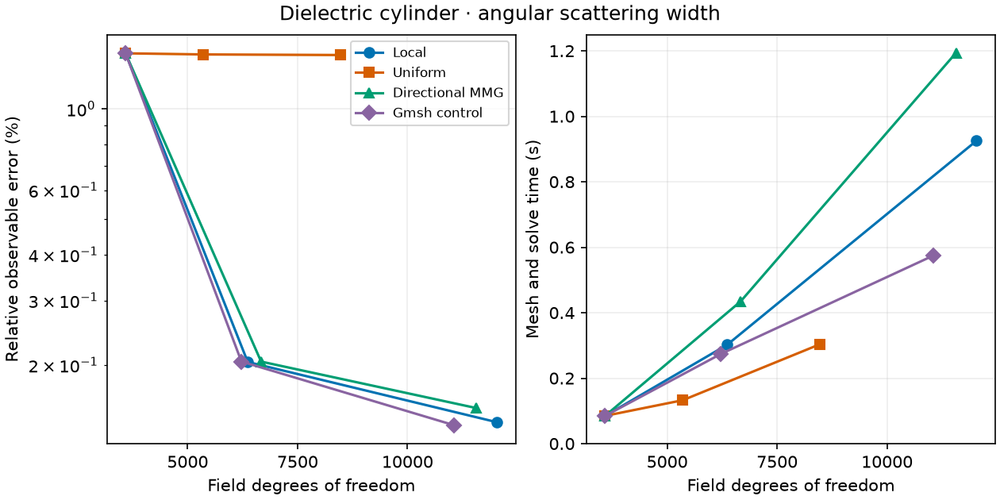

# Scattering from a dielectric cylinder

A TM plane wave with free-space wavelength 1 m illuminates a cylinder of radius 0.14 m and relative permittivity 9. The domain extends from −1 to +1 m in both axes, with six PML layers and initial h = 0.10 m.

The cylindrical-wave series uses orders −18 through 18. The relative norm of the scattering-width error uses 19 angles from 0° to 180°.

Gmsh local and scalar MMG reached nearly the same accuracy after two passes (0.137% and 0.140%). Gmsh used fewer DOFs and less time. Uniform sizing stayed near 1.40% across all three meshes.



| Strategy | Level | Elements | Field DOFs | Error (%) | Estimator | Time (s) | Peak MiB | Refinement backend |
| --- | --- | --- | --- | --- | --- | --- | --- | --- |
| initial | 0 | 782 | 3,589 | 1.417 | 0.0328 | 0.0849 | 102.1 | Initial mesh |
| local | 1 | 2,046 | 6,367 | 0.2039 | 0.0128 | 0.302 | 118.8 | mmg2d |
| uniform | 1 | 1,364 | 5,353 | 1.407 | 0.0242 | 0.133 | 109.9 | Initial mesh |
| anisotropic | 1 | 2,198 | 6,671 | 0.2044 | 0.0139 | 0.435 | 120.6 | mmg2d |
| local | 2 | 4,317 | 12,034 | 0.1397 | 0.00566 | 0.925 | 148.6 | mmg2d / mmg2d |
| uniform | 2 | 2,426 | 8,477 | 1.402 | 0.0216 | 0.304 | 122.6 | Initial mesh |
| anisotropic | 2 | 4,159 | 11,568 | 0.1527 | 0.0067 | 1.19 | 145.8 | mmg2d / mmg2d |
| gmsh | 1 | 1,974 | 6,223 | 0.2045 | 0.0135 | 0.274 | 116.7 | gmsh |
| gmsh | 2 | 3,912 | 11,049 | 0.1372 | 0.00658 | 0.574 | 142.4 | gmsh / gmsh |

Each row is a fresh CPU solve. Uniform levels divide the initial h by 1.5 or 2.25 and solve once. Local levels allow one or two refinements. All runs reached their configured refinement limit at tolerance 10⁻¹⁰. Single-run times include mesh, solve and observable evaluation. Peak resident memory includes the Python process.

[Measured rows](data/amr_observables.csv) · [Gmsh-only control](data/gmsh_control.csv)

## Reproduce

```sh
python benchmarks/analytical/amr_observables.py --cases inclusion --levels 0 1 2 --anisotropic --output results.csv
python benchmarks/analytical/amr_observables.py --cases inclusion --levels 1 2 --gmsh-control --output control.csv
python benchmarks/analytical/plot_amr_observables.py results.csv control.csv --output plots
```

[Benchmark index](README.md)
