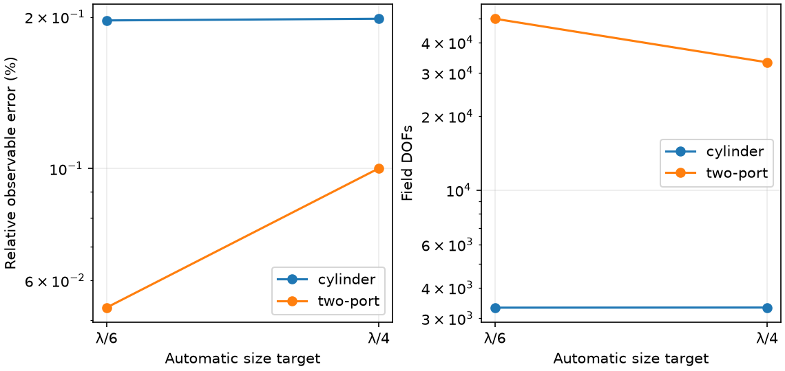

# Automatic quadratic initial mesh · λ/4 versus λ/6

The same quadratic scattering and antenna problems were solved on their initial meshes. These results compare the historical λ/6 and λ/4 background targets with material-aware CAD sizing in both runs. The reproduction script pins the wavelength divisor for the two-port antenna because its automatic target now depends on the guide geometry and fill material.

The TM cylinder has radius 0.14 m and index 3. The angular width error uses 19 directions and the Bessel/Hankel expansion. The two-port guide is 0.72 × 0.30 × 0.55 m; its complex S₂₁ is compared with exp(−iβL). Both use a 1 m free-space wavelength and CPU solves.

| Problem | Target | Physical cells | Field DOFs | Observable error (%) | Time (s) |
| --- | --- | --- | --- | --- | --- |
| cylinder | λ/6 | 946 | 3,317 | 0.1968 | 0.113 |
| cylinder | λ/4 | 948 | 3,321 | 0.1983 | 0.088 |
| two-port | λ/6 | 3,950 | 49,960 | 0.05299 | 6.09 |
| two-port | λ/4 | 2,592 | 33,186 | 0.1001 | 2.89 |



The guide used 33.6% fewer DOFs at λ/4 and the transmission error rose from 0.0530% to 0.100%. The cylinder changed from 3,317 to 3,321 DOFs: other sizing constraints dominated these two nonnested meshes. The background target alone cannot predict cell count.

[Measured rows](data/initial_wavelength/comparison.csv)

## Reproduce

```sh
python benchmarks/analytical/initial_wavelength.py --output results
```

[Benchmark index](README.md)
