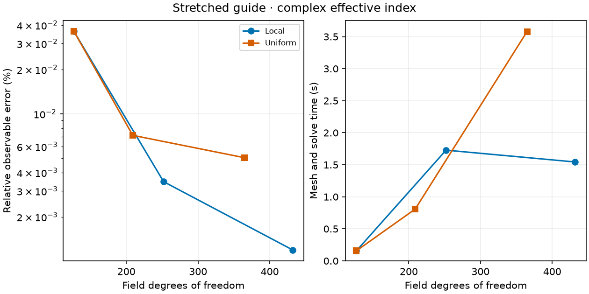

# Complex mode of a stretched guide

A TE guide spans 1 m transversely and repeats every 0.15 m. The two absorbing layers each have thickness 0.1 m, cubic grading and peak stretch coefficient 3. Initial h is 0.14 m. Uniform runs also set the PML layer count to max(1, round(0.14/h)).

Integrating the coordinate stretch gives complex width W = 1 − 2i × 0.1 × 3/4 m. At free-space wavelength 1 m the reference is √[1 − (0.5/W)²]. The error uses the complex index, including attenuation.

Local Gmsh reached 0.00119% index error after two passes at 432 DOFs. Uniform sizing gave 0.00504% at 365 DOFs.



| Strategy | Level | Elements | Field DOFs | Error (%) | Estimator | Time (s) | Peak MiB | Refinement backend |
| --- | --- | --- | --- | --- | --- | --- | --- | --- |
| initial | 0 | 50 | 127 | 0.03621 | 0.159 | 0.157 | 94.2 | Initial mesh |
| local | 1 | 107 | 252 | 0.003464 | 0.0479 | 1.73 | 107.8 | gmsh |
| uniform | 1 | 88 | 209 | 0.007146 | 0.07 | 0.809 | 101.5 | Initial mesh |
| local | 2 | 193 | 432 | 0.001192 | 0.0255 | 1.54 | 108.6 | gmsh / gmsh |
| uniform | 2 | 158 | 365 | 0.005036 | 0.0564 | 3.58 | 126.0 | Initial mesh |

Each row is a fresh CPU solve. Uniform levels divide the initial h by 1.5 or 2.25 and solve once. Local levels allow one or two refinements. All runs reached their configured refinement limit at tolerance 10⁻¹⁰. Single-run times include mesh, solve and observable evaluation. Peak resident memory includes the Python process.

[Measured rows](data/amr_observables.csv)

## Reproduce

```sh
python benchmarks/analytical/amr_observables.py --cases leaky_mode --levels 0 1 2 --output results.csv
python benchmarks/analytical/plot_amr_observables.py results.csv --output plots
```

[Benchmark index](README.md)
