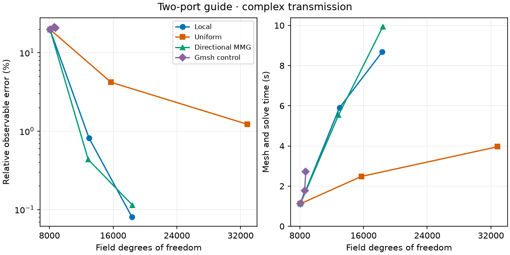

# Transmission through a two-port guide

The PEC guide is 0.72 m wide, 0.30 m high and 0.55 m long. A single modal port terminates each end. Free-space wavelength is 1 m. The initial mesh uses first-order elements, h = 0.19 m and one outer PML layer.

The TE₁₀ reference is S₂₁ = exp(−iβL), with β = √[(2π)² − (π/0.72)²] rad/m. The complex error tests transmission phase and amplitude together.

Scalar MMG gave the lowest two-pass error (0.0808%), followed by directional MMG (0.114%), uniform sizing (1.22%) and the Gmsh local control (20.6%). Scalar MMG used 18,342 DOFs versus 32,842 for uniform, but took longer and used more memory. The Gmsh control added few DOFs in this problem.



| Strategy | Level | Elements | Field DOFs | Error (%) | Estimator | Time (s) | Peak MiB | Refinement backend |
| --- | --- | --- | --- | --- | --- | --- | --- | --- |
| initial | 0 | 3,183 | 8,070 | 19.78 | 2.15 | 1.12 | 143.5 | Initial mesh |
| local | 1 | 7,294 | 12,973 | 0.814 | 1.22 | 5.9 | 483.1 | mmg3d |
| uniform | 1 | 6,440 | 15,736 | 4.189 | 1.27 | 2.48 | 174.5 | Initial mesh |
| anisotropic | 1 | 7,204 | 12,865 | 0.4339 | 1.19 | 5.54 | 815.6 | mmg3d |
| local | 2 | 10,701 | 18,342 | 0.0808 | 0.756 | 8.68 | 518.5 | mmg3d / mmg3d |
| uniform | 2 | 14,129 | 32,842 | 1.223 | 0.866 | 3.96 | 249.6 | Initial mesh |
| anisotropic | 2 | 10,814 | 18,432 | 0.1137 | 0.703 | 9.94 | 847.2 | mmg3d / mmg3d |
| gmsh | 1 | 3,585 | 8,614 | 21.12 | 2.19 | 1.77 | 152.8 | gmsh |
| gmsh | 2 | 3,631 | 8,749 | 20.62 | 2.19 | 2.72 | 157.4 | gmsh / gmsh |

Each row is a fresh CPU solve. Uniform levels divide the initial h by 1.5 or 2.25 and solve once. Local levels allow one or two refinements. All runs reached their configured refinement limit at tolerance 10⁻¹⁰. Single-run times include mesh, solve and observable evaluation. Peak resident memory includes the Python process.

[Measured rows](data/amr_observables.csv) · [Gmsh-only control](data/gmsh_control.csv)

## Reproduce

```sh
python benchmarks/analytical/amr_observables.py --cases multiport --levels 0 1 2 --anisotropic --output results.csv
python benchmarks/analytical/amr_observables.py --cases multiport --levels 1 2 --gmsh-control --output control.csv
python benchmarks/analytical/plot_amr_observables.py results.csv control.csv --output plots
```

[Benchmark index](README.md)
