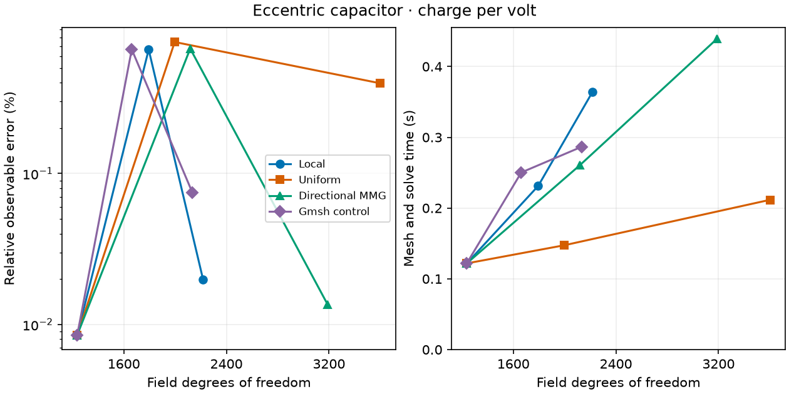

# Eccentric capacitor

Two circular conductors of radii 0.17 and 0.38 m are offset by 0.18 m, leaving a minimum vacuum gap of 0.03 m. The inner conductor is at 1 V and the shield is grounded. The initial size target is 0.12 m. The CAD sagitta target is h²/3 in the benchmark's metre coordinates.

The charge per metre on the inner conductor gives capacitance per metre at 1 V. The exact solution is 2πε₀ / acosh[(R² + r² − d²)/(2Rr)], with outer radius R, inner radius r and offset d.

The initial charge error was only 0.00853%. Every first refinement increased it even as the flux estimator decreased. On the second pass the directional metric gave 0.0135% error, versus 0.0199% for scalar MMG and 0.0751% for Gmsh. The uniform level also tightens the curvature target, so this comparison includes geometric discretization.



| Strategy | Level | Elements | Field DOFs | Error (%) | Estimator | Time (s) | Peak MiB | Refinement backend |
| --- | --- | --- | --- | --- | --- | --- | --- | --- |
| Initial | 0 | 586 | 1,237 | 0.008525 | 0.366 | 0.122 | 92.5 | Initial mesh |
| Local | 1 | 863 | 1,794 | 0.6624 | 0.182 | 0.231 | 102.8 | mmg2d |
| Uniform | 1 | 952 | 1,997 | 0.7437 | 0.187 | 0.147 | 93.3 | Initial mesh |
| Directional MMG | 1 | 1,025 | 2,118 | 0.6719 | 0.158 | 0.26 | 108.6 | mmg2d |
| Local | 2 | 1,073 | 2,218 | 0.01989 | 0.112 | 0.364 | 103.5 | mmg2d / mmg2d |
| Uniform | 2 | 1,734 | 3,601 | 0.396 | 0.128 | 0.212 | 96.4 | Initial mesh |
| Directional MMG | 2 | 1,559 | 3,190 | 0.01354 | 0.0858 | 0.439 | 110.0 | mmg2d / mmg2d |
| Gmsh control | 1 | 797 | 1,662 | 0.6643 | 0.173 | 0.25 | 94.1 | gmsh |
| Gmsh control | 2 | 1,031 | 2,134 | 0.07507 | 0.101 | 0.287 | 95.2 | gmsh / gmsh |

Each row is an independent CPU solve. Local levels allow one or two refinements from the same initial mesh. Uniform levels divide h by 1.5 or 2.25 and solve once. The tolerance of 10⁻¹⁰ exposes both passes. Every run stopped at its refinement budget. Times are single observations including meshing, solving and observable evaluation. Peak resident memory includes the Python process.

[Measured rows](data/amr_observables.csv) · [Gmsh-only control](data/gmsh_control.csv)

## Reproduce

```sh
python benchmarks/analytical/amr_observables.py --cases narrow_gap --levels 0 1 2 --anisotropic --output results.csv
python benchmarks/analytical/amr_observables.py --cases narrow_gap --levels 1 2 --gmsh-control --output control.csv
python benchmarks/analytical/plot_amr_observables.py results.csv control.csv --output plots
```

[Benchmark index](README.md)
