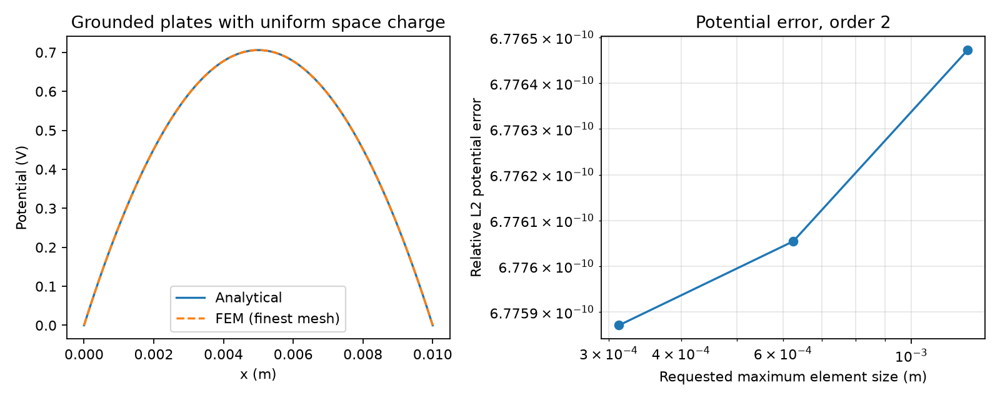

# Parallel-plate electrostatics

Quadratic elements span a 10 mm dielectric gap with εᵣ = 2. Plates held at 0 and 10 V have a linear potential and C = εA/L. The 2D plate height is 5 mm. A separate grounded 1D interval with uniform charge density 10⁻⁶ C/m³ has V(x) = ρx(L − x)/(2ε). Its relative L² error uses 4,001 samples.

**Passed.** The charged quadratic potential had a relative error of 6.78 × 10⁻¹⁰ at every resolution. Both the linear potential and quadratic charge profile are represented by this element order. Capacitor potential uses the maximum nodal error divided by 10 V. Capacitance and energy met their 10⁻⁷ relative limits.

| Problem | L/h | Nodes | Potential error | Capacitance | Units | Relative energy error |
| --- | --- | --- | --- | --- | --- | --- |
| capacitor_1d | 8 | 17 | 2.84e-15 | 1.770838e-9 | F/m^2 | 6.78e-10 |
| capacitor_2d | 8 | 122 | 6.31e-15 | 8.854188e-12 | F/m | 6.78e-10 |
| space_charge_1d | 8 | 17 | 6.78e-10 | — | — | — |
| capacitor_1d | 16 | 33 | 2.87e-14 | 1.770838e-9 | F/m^2 | 6.78e-10 |
| capacitor_2d | 16 | 302 | 2.13e-15 | 8.854188e-12 | F/m | 6.78e-10 |
| space_charge_1d | 16 | 33 | 6.78e-10 | — | — | — |
| capacitor_1d | 32 | 65 | 3.03e-14 | 1.770838e-9 | F/m^2 | 6.78e-10 |
| capacitor_2d | 32 | 864 | 2.03e-14 | 8.854188e-12 | F/m | 6.78e-10 |
| space_charge_1d | 32 | 65 | 6.78e-10 | — | — | — |



[Current data](data/parallel_plate_electrostatics/comparison.csv) · [October reference](../../benchmarks/reference_results/parallel_plate_electrostatics/comparison.csv) · [Potential profile](data/parallel_plate_electrostatics/potential.csv)

## Reproduce

```sh
python benchmarks/analytical/parallel_plate_electrostatics.py --check --output results
```

[Benchmark index](README.md)
