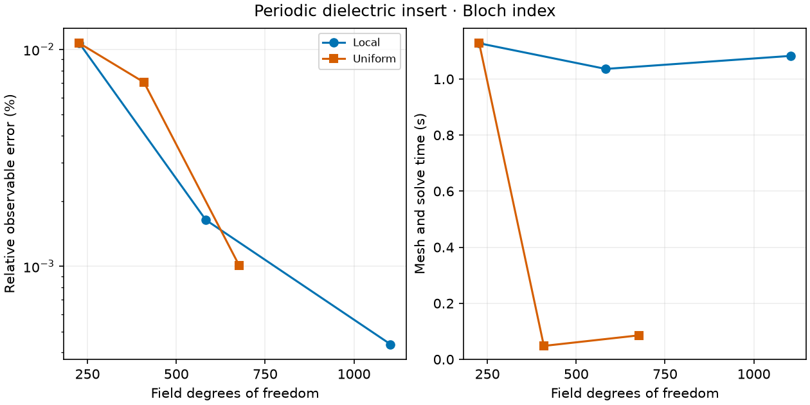

# Periodic dielectric insert

A 1 m wide PEC guide repeats every 0.20 m along z. A layer of relative permittivity 4 fills the cross section over z = 0.08–0.12 m. The TE calculation uses a 1 m free-space wavelength and initial size target of 0.16 m.

The half-trace of the two-layer transfer matrix gives cos(βL). The solver finds the mode nearest the resulting Bloch effective index β/k₀.

Local Gmsh reduced index error to 0.000437%, compared with 0.00101% on the uniform mesh. It used 1,103 versus 677 DOFs. Both local passes regenerated matching periodic seams.



| Strategy | Level | Elements | Field DOFs | Error (%) | Estimator | Time (s) | Peak MiB | Refinement backend |
| --- | --- | --- | --- | --- | --- | --- | --- | --- |
| initial | 0 | 102 | 227 | 0.01068 | 0.0888 | 1.13 | 105.9 | Initial mesh |
| local | 1 | 272 | 583 | 0.001635 | 0.0282 | 1.04 | 105.6 | gmsh |
| uniform | 1 | 188 | 409 | 0.007051 | 0.0613 | 0.048 | 92.5 | Initial mesh |
| local | 2 | 518 | 1,103 | 0.0004366 | 0.014 | 1.08 | 105.9 | gmsh / gmsh |
| uniform | 2 | 316 | 677 | 0.001008 | 0.0235 | 0.0857 | 93.6 | Initial mesh |

Each row is a fresh CPU solve. Uniform levels divide the initial h by 1.5 or 2.25 and solve once. Local levels allow one or two refinements. All runs reached their configured refinement limit at tolerance 10⁻¹⁰. Single-run times include mesh, solve and observable evaluation. Peak resident memory includes the Python process.

[Measured rows](data/amr_observables.csv)

## Reproduce

```sh
python benchmarks/analytical/amr_observables.py --cases periodic_defect --levels 0 1 2 --output results.csv
python benchmarks/analytical/plot_amr_observables.py results.csv --output plots
```

[Benchmark index](README.md)
