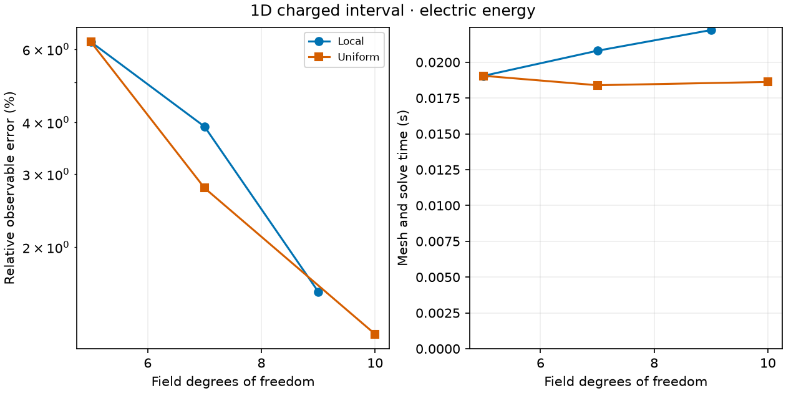

# 1D charged interval · electric energy

A uniform vacuum charge density ρ = ε₀ C/m³ fills a unit interval with grounded ends. Quantities are per unit area. Linear elements start at h = .25 m. The exact potential is V = x(1 − x)/2 at x in metres. Integrating ε₀|∇V|²/2 gives reference energy ε₀/24 J/m².

Native bisection lowered energy error from 6.25% to 1.56% in two passes. Uniform sizing gave 1.23% with one additional DOF. The exact potential has constant curvature, so uniform spacing is an effective control.

| Strategy | Level | Elements | Scalar DOFs | Energy error (%) | Estimator | Time (s) | Peak MiB |
| --- | --- | --- | --- | --- | --- | --- | --- |
| initial | 0 | 4 | 5 | 6.25 | 1.18 | 0.019 | 87.0 |
| local | 1 | 6 | 7 | 3.906 | 0.852 | 0.0208 | 86.9 |
| uniform | 1 | 6 | 7 | 2.778 | 0.793 | 0.0184 | 87.0 |
| local | 2 | 8 | 9 | 1.562 | 0.598 | 0.0222 | 86.9 |
| uniform | 2 | 9 | 10 | 1.235 | 0.532 | 0.0186 | 87.0 |



The local runs started from the same mesh, used tolerance 10⁻¹⁰ and stopped at their refinement budgets. Uniform h was divided by 1.5 per level. DOFs count all scalar potential coefficients, including prescribed boundary values. Time and process memory are single observations.

[Measured rows](data/charged_plates.csv)

## Reproduce

```sh
python benchmarks/analytical/amr_observables.py --cases plate_1d --output results.csv
```

[Benchmark index](README.md)
