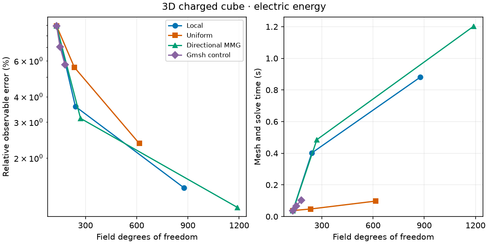

# 3D charged cube · electric energy

A uniform vacuum charge density ρ = ε₀ C/m³ fills a unit cube. The x faces are grounded and the four transverse faces have zero normal flux. Linear elements start at h = .30 m. The exact potential is V = x(1 − x)/2 at x in metres. Integrating ε₀|∇V|²/2 gives reference energy ε₀/24 J.

The directional MMG mesh reached 1.14% energy error with 1,190 scalar DOFs, versus 1.43% with 876 DOFs for isotropic MMG and 2.36% with 615 DOFs for uniform sizing. Peak memory was highest for the tensor metric.

| Strategy | Level | Elements | Scalar DOFs | Energy error (%) | Estimator | Time (s) | Peak MiB |
| --- | --- | --- | --- | --- | --- | --- | --- |
| initial | 0 | 340 | 131 | 8.899 | 1.92 | 0.0377 | 92.3 |
| local | 1 | 961 | 241 | 3.584 | 1.22 | 0.401 | 449.1 |
| uniform | 1 | 734 | 235 | 5.578 | 1.52 | 0.0475 | 93.4 |
| anisotropic | 1 | 1,130 | 271 | 3.133 | 1.16 | 0.486 | 781.1 |
| local | 2 | 4,130 | 876 | 1.431 | 0.767 | 0.88 | 450.8 |
| uniform | 2 | 2,237 | 615 | 2.359 | 0.99 | 0.0974 | 99.5 |
| anisotropic | 2 | 5,813 | 1,190 | 1.144 | 0.686 | 1.2 | 784.3 |
| gmsh | 1 | 438 | 151 | 7.043 | 1.76 | 0.0673 | 93.7 |
| gmsh | 2 | 598 | 180 | 5.748 | 1.54 | 0.104 | 94.2 |



The local runs started from the same mesh, used tolerance 10⁻¹⁰ and stopped at their refinement budgets. Uniform h was divided by 1.5 per level. DOFs count all scalar potential coefficients, including prescribed boundary values. Time and process memory are single observations.

[Measured rows](data/charged_plates.csv) · [Gmsh-only control](data/plate_control.csv)

## Reproduce

```sh
python benchmarks/analytical/amr_observables.py --cases plate_3d --anisotropic --output results.csv
python benchmarks/analytical/amr_observables.py --cases plate_3d --levels 1 2 --gmsh-control --output control.csv
```

[Benchmark index](README.md)
