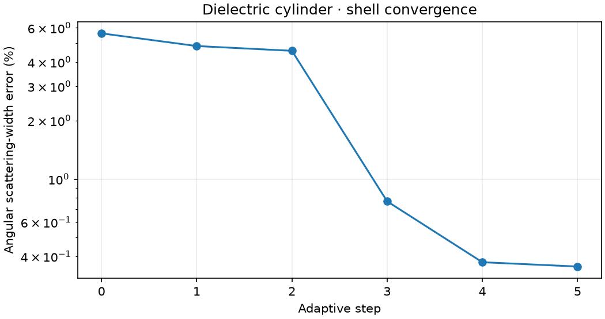

# Absorbing-layer convergence against cylinder scattering

At a free-space wavelength of 1 m, a TM plane wave illuminates a radius-0.18 m cylinder of relative permittivity 2.25. The initial physical mesh target is 0.08 m and the shell begins with one layer. The observable is the scattering width at 19 angles from 0° to 180°. Its analytical reference uses a cylindrical-wave series through order 18.

The physical stopping tolerance is 0.015. Once it is met, only the shell is doubled. The shell tolerance is 0.005 on the relative change in angular width between consecutive solutions on the same physical mesh. The table compares each result independently with the analytical width.

| Step | Physical cells | Field DOFs | Layers | Physical estimator | PML volume | PML entrance | Width error (%) | Decision |
| --- | --- | --- | --- | --- | --- | --- | --- | --- |
| 0 | 948 | 2,261 | 1 | 0.038 | 1.19 | 0.181 | 5.618 | refine |
| 1 | 2,473 | 5,476 | 1 | 0.0159 | 1.19 | 0.177 | 4.834 | refine |
| 2 | 4,415 | 9,630 | 1 | 0.00863 | 1.2 | 0.174 | 4.569 | pml_refine |
| 3 | 4,415 | 10,306 | 2 | 0.00857 | 0.397 | 0.0359 | 0.768 | pml_refine |
| 4 | 4,415 | 11,754 | 4 | 0.00827 | 0.112 | 0.0045 | 0.3734 | pml_refine |
| 5 | 4,415 | 15,034 | 8 | 0.00824 | 0.0334 | 0.000714 | 0.3548 | tolerance |



**Passed.** The physical criterion first passed with 4.57% angular error. Keeping all 4,415 physical cells and increasing the shell from one to eight layers reduced error to 0.355%. The shell convergence decision agreed with the independent 1% accuracy check.

[Measured rows](data/pml_convergence/comparison.csv)

## Reproduce

```sh
python benchmarks/analytical/pml_convergence.py --output results
```

[Benchmark index](README.md)
