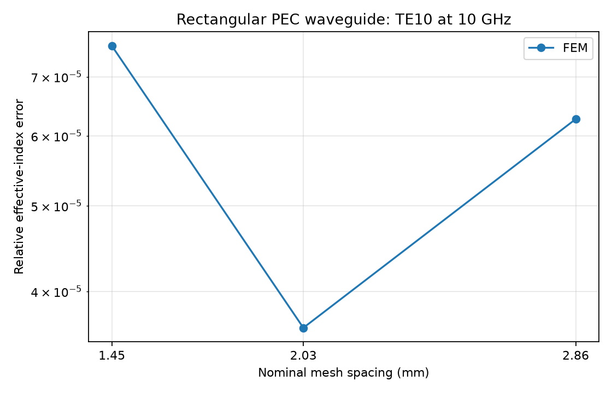

# Rectangular PEC waveguide

At 10 GHz, the vacuum guide is 22.86 × 10.16 mm. The TE₁₀ solution has β = √[k₀² − (π/a)²] = 158.23826 rad/m and effective index 0.75500934. Each resolution builds an independent first-order triangular mesh; AMR is disabled.

**Passed.** All three meshes gave less than 0.008% index error. The middle mesh gave the smallest error. The finest result reproduces the October reference to the displayed precision and satisfies the benchmark’s 1% limit.

| Cells across width | Triangles | Target (mm) | FEM index | Index error (%) | Algebraic residual |
| --- | --- | --- | --- | --- | --- |
| 8 | 342 | 2.857 | 0.75496202 | 0.006268 | 5.07e-14 |
| 12 | 448 | 2.032 | 0.75498187 | 0.003638 | 7.56e-14 |
| 16 | 692 | 1.451 | 0.75495206 | 0.007586 | 1.03e-12 |



[Current data](data/rectangular_waveguide_modes/comparison.csv) · [October reference](../../benchmarks/reference_results/rectangular_waveguide_modes/comparison.csv)

## Reproduce

```sh
python benchmarks/analytical/rectangular_waveguide_modes.py --check --output results
```

[Benchmark index](README.md)
