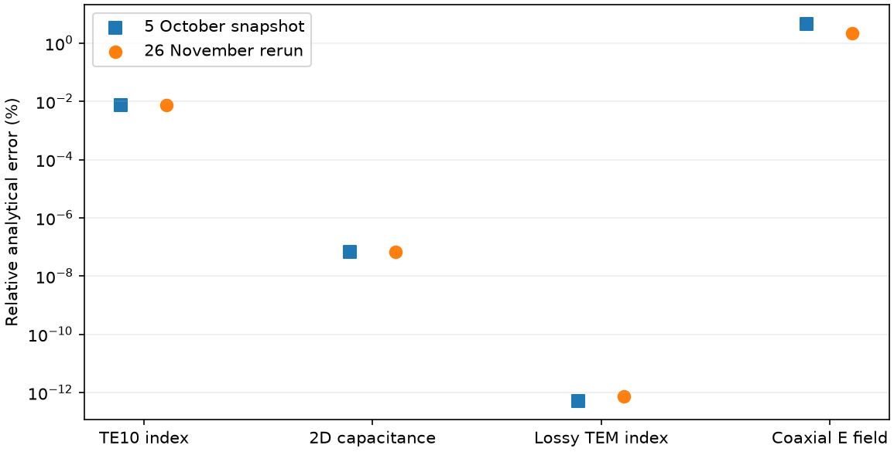

# Four checked references · October and November

The 5 October reference was recorded on a modified tree based on `477bc5e`; its source hash is in the archived manifest. The 26 November run uses solver revision `6ada998`. Both snapshots pass the four runners’ analytical checks. The selected rows use the same physical quantity, units and nominal resolution or refinement budget.

| Observable | Compared configuration | October error (%) | November error (%) |
| --- | --- | --- | --- |
| TE10 index | 16 width divisions | 0.0075864 | 0.0075864 |
| 2D capacitance | 32 cells across gap | 6.7766e-8 | 6.7766e-8 |
| Lossy TEM index | 12 GHz, lossy fill | 5.1841e-13 | 7.4025e-13 |
| Coaxial E field | 4 refinement passes | 4.6574 | 2.2466 |



The TE₁₀ result reproduces to the displayed precision. The plate and TEM benchmarks stay near their numerical floors. Coaxial field error fell from 4.66% to 2.25%, with 7,744 final triangles versus 3,178 in October. Its initial mesh also changed (178 versus 125 triangles), so the error reduction alone cannot be attributed to a backend or interpreted as a speedup. The paired November local-versus-uniform field-target run controls the initial mesh.

[Compared values](data/reference_comparison.csv) · [Historical source manifest](../../benchmarks/reference_results/manifest.json) · [November matched-target coax study](coaxial_waveguide_adaptivity.md)

## Reproduce

```sh
python benchmarks/analytical/rectangular_waveguide_modes.py --check
python benchmarks/analytical/parallel_plate_electrostatics.py --check
python benchmarks/analytical/uniform_periodic_medium.py --check
python benchmarks/analytical/coaxial_waveguide_adaptivity.py --check
```

[Benchmark index](README.md)
