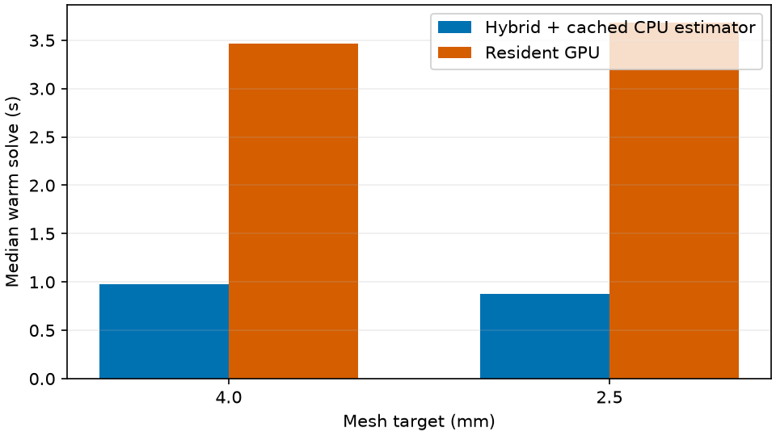

# 3D periodic iris · cached CPU estimator control

The same two-mode iris case compares a resident GPU solve with a hybrid solve whose residual estimator operates on host copies of the prepared geometry. Host copies are made once before the timer. Matrix factorization and Arnoldi still use the GPU in both paths. Only warm runs are timed. The benchmark checks agreement of the adaptive residual after each measured solve.

Mesh targets are 4 and 2.5 mm. The CPU BLAS/OpenMP limit was one thread. Each entry is the median of three alternating pairs on the RTX 4070 Laptop. A separate simulation used the GPU during this benchmark session.

| h (mm) | Field DOFs | Hybrid (s) | Resident (s) | Hybrid / resident |
| --- | --- | --- | --- | --- |
| 4.0 | 1,595 | 0.9764 | 3.464 | 0.282× |
| 2.5 | 3,666 | 0.8778 | 3.68 | 0.239× |



The cached CPU control also ran faster on both meshes. The per-repeat adaptive residual differences were below 2 × 10⁻¹⁵.

[Raw samples](data/resident_cached_cpu/samples.csv) · [Summary](data/resident_cached_cpu/summary.csv)

## Reproduce

```sh
python benchmarks/benchmark_resident_cached_cpu.py --sizes-mm 4 2.5 --repeats 3 --output results
```

[Benchmark index](README.md)
