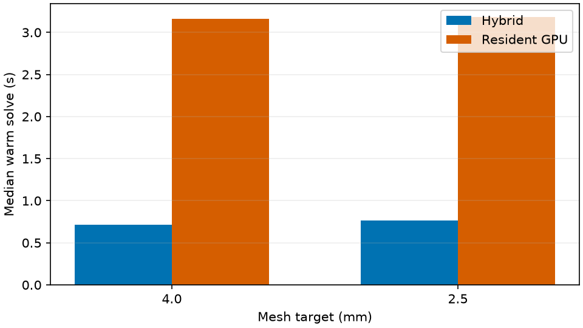

# 3D periodic iris · hybrid versus resident GPU

Both paths solve a first-order vacuum iris cell for two modes, using ncv = 96. Hybrid uses CPU Ritz extraction and GPU Arnoldi. Resident keeps Ritz extraction on the device. Both include field reconstruction, normalization and the error estimator and refactorize on every solve. Assembly is excluded. Initial solves and prepared-geometry time are recorded separately.

Mesh targets are 4 and 2.5 mm. The CPU BLAS/OpenMP limit was one thread. Each entry is the median of three alternating pairs on the RTX 4070 Laptop. A separate simulation used the GPU during this benchmark session.

| h (mm) | Field DOFs | Hybrid (s) | Resident (s) | Hybrid / resident |
| --- | --- | --- | --- | --- |
| 4.0 | 1,595 | 0.7179 | 3.159 | 0.227× |
| 2.5 | 3,666 | 0.7628 | 3.181 | 0.24× |



Hybrid ran faster on both meshes. The maximum mode-index difference was below 5 × 10⁻¹⁵. The maximum relative coefficient and estimator differences are retained in the summary for each mesh.

[Raw samples](data/resident_periodic_3d/samples.csv) · [Summary](data/resident_periodic_3d/summary.csv)

## Reproduce

```sh
python benchmarks/benchmark_resident_periodic_3d.py --sizes-mm 4 2.5 --repeats 3 --output results
```

[Benchmark index](README.md)
