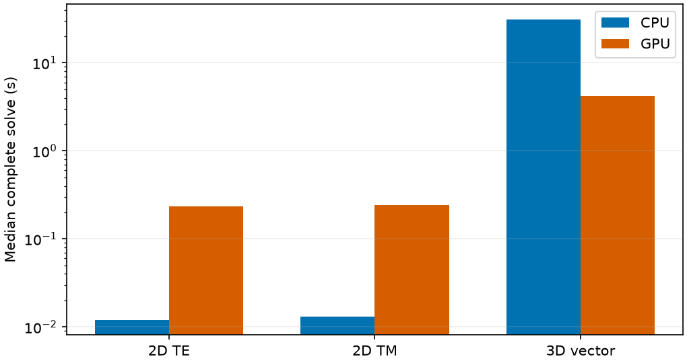

# Direct copper scattering · CPU versus cuDSS

A 3 GHz plane wave illuminates a copper circle (TE and TM) or sphere in a 0.12 m-wide domain. The target has radius 0.015 m. Each first-order mesh uses h = 0.025 m. Both backends solve the identical mesh with AMR disabled. After warmup, three alternating CPU/GPU pairs give the median wall times below. An independent simulation was using the laptop GPU during this run.

| Problem | DOFs | CPU (s) | cuDSS (s) | CPU / cuDSS |
| --- | --- | --- | --- | --- |
| 2D TE | 412 | 0.012 | 0.235 | 0.051× |
| 2D TM | 412 | 0.013 | 0.243 | 0.053× |
| 3D vector | 35,723 | 31.289 | 4.214 | 7.42× |



**Passed.** Each GPU solve used cuDSS. The runner checked the complex scattered field (relative tolerance 10⁻⁷ and absolute tolerance 10⁻⁸) and backscatter (relative tolerance 10⁻⁷) against CPU. Absolute times vary with GPU load.

[Runner output](data/scattering_cudss.txt)

## Reproduce

```sh
python benchmarks/benchmark_scattering_cudss.py --element-order 1 --size .025 --repeats 3
```

[Benchmark index](README.md)
