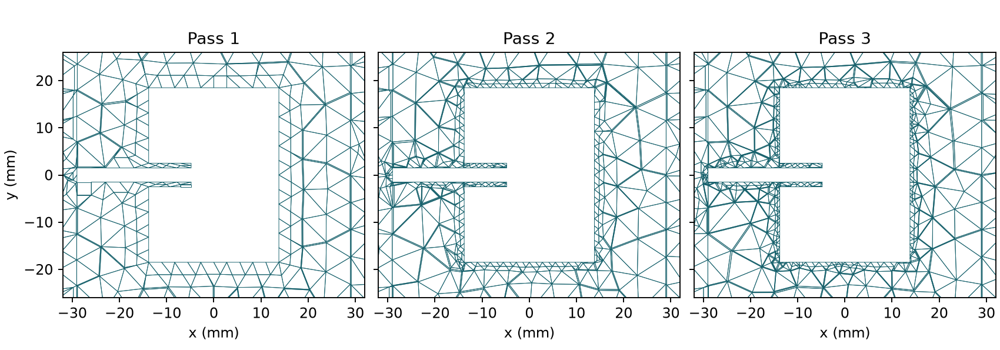
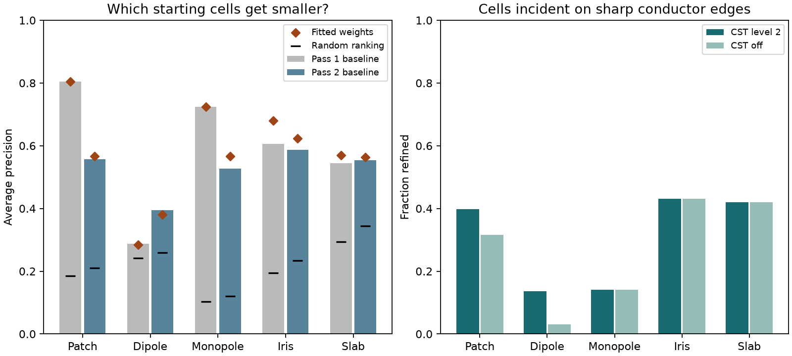

# Where CST refines antennas and waveguide discontinuities

The first CST mesh of the inset-fed patch already had smaller cells around the feed. During the first adaptive pass, 83% of the cells near the feed and inset gained at least 50% in local cell density. Only 5.7% of cells in the surrounding region crossed that threshold. Turning off CST's singular-edge refinement reduced the feed-and-inset fraction to 65%. Both runs started with the same tetrahedra.



The cut is at z = 1.7 mm, halfway through the top metal. White regions inside the patch and feed are PEC. The two narrow horizontal channels beside the feed are the inset slots. The first two ParaView files include FEM's local marking scores and the measured change on the following CST pass. [Initial patch mesh](data/shared_mesh/patch_1.vtu) · [Pass two](data/shared_mesh/patch_2.vtu) · [Pass three](data/shared_mesh/patch_3.vtu)

## Five frequency-domain cases

The measurements used CST Studio Suite 2025.0, build 1315043, on 27 November 2026. CST generated the initial mesh with its automatic tetrahedral sizing. We held the excitation, frequency and second-order solver fixed for each case. The table gives the median longest edge in the first solved mesh and the percentage of starting cells that gained at least 50% in local density in the first refinement. Regions are defined from physical coordinates in the analysis script. Full region populations and edge-length measurements are in the CSV.

| Geometry | Frequency | Region | Median initial edge, region / surroundings | Fraction refined, region / surroundings |
| --- | ---: | --- | ---: | ---: |
| Inset-fed patch, 27.6 × 37 mm on 1.6 mm FR-4 | 2.45 GHz | Feed and inset | 6.1 / 12.1 mm | 82.7% / 5.7% |
| Centre-fed dipole, two square-section arms, 58 mm tip to tip | 2.45 GHz | Feed gap | 6.4 / 32.1 mm | 3.6% / 38.2% |
| 29 mm monopole above a finite 58 mm square ground | 2.45 GHz | Arm tip | 11.7 / 12.9 mm | 100% / 6.8% |
| WR-90, 11 mm iris aperture, 2 mm thick | 10 GHz | Aperture edge | 5.2 / 5.2 mm | 76.5% / 4.8% |
| WR-90, 6 mm full-height dielectric slab, εᵣ = 2.25 | 10 GHz | Within 1 mm of a slab interface | 5.1 / 5.1 mm | 43.3% / 24.9% |

The dipole illustrates why a fixed feed multiplier can be misleading. Its feed started much finer than its surroundings. On the following pass CST preferentially added resolution elsewhere. The iris shows the opposite pattern: its aperture and surrounding guide started with comparable edge lengths, then CST concentrated refinement at the aperture. [All regional measurements](data/shared_mesh/regions.csv)

The three antenna models use PEC conductors, a 50 Ω discrete edge port and open boundaries with 25 mm air clearance. The patch uses εᵣ = 4.4 and tan δ = 0.02. This controlled patch shares the repository example's board and inset dimensions. The example uses copper and an enclosed microstrip wave port. The guides use PEC walls, one TE₁₀ mode at each end, and excitation at port one.

## Separating initial meshing from adaptive decisions

CST's installed Help topic **Adaptive Tetrahedral Mesh Refinement (Frequency Domain)** describes estimating local field error, selecting high-error edges, splitting them directionally, and improving mesh quality. It also describes additional refinement at conductor edges. We tested that control directly by comparing its default level 2 against level 0. We forced two or three passes to observe transitions, irrespective of whether ΔS had settled.

For second-order fields the Help describes a default 5–30% refinement range. The percentage influences both the share of estimated error selected and approximate mesh growth. Wavelength pre-refinement, singular-edge refinement and quality improvement can change the resulting count. In the patch run CST's log also reported that it based the growth limit on an estimated 11,624 cells, even though the initial mesh contained 2,884. Entering the same percentage as FEM's bulk-marking fraction would give it a different meaning.

| Model | Level 2, initial → second → third | Level 0, initial → second | Fraction of sharp-edge cells refined on the first update, level 2 / off |
| --- | --- | --- | ---: |
| [Patch](data/shared_mesh/patch_passes.csv) | 2,884 → 4,512 → 6,753 | 2,884 → 3,661 | 39.7% / 31.6% |
| [Dipole](data/shared_mesh/dipole_passes.csv) | 479 → 724 → 1,044 | 479 → 645 | 13.7% / 3.1% |
| [Monopole, controlled start](data/shared_mesh/monopole_passes.csv) | 2,104 → 2,743 → 3,380 | 2,104 → 2,743 | 14.1% / 14.1% |
| [Iris](data/shared_mesh/iris_passes.csv) | 1,136 → 1,600 → 2,300 | 1,136 → 1,600 | 43.1% / 43.1% |
| [Dielectric slab](data/shared_mesh/dielectric_step_passes.csv) | 1,210 → 1,928 → 3,233 | 1,210 → 1,928 | 42.0% / 42.0% |

For this measurement a sharp-edge cell touches an edge shared by two conductor faces with more than 35° between their unoriented normals. This geometric classification is ours. The unchanged iris result shows that the field-based strategy can concentrate cells at an aperture even with the additional edge control disabled.

The default monopole run exposed an extra step. CST generated 2,104 tetrahedra, applied wavelength-based refinement to 0.3% of the edges, then solved on 2,128 cells. Its saved original mesh contained the earlier 2,104. The default pass-two counts were 3,022 at level 2 and 2,774 at level 0. For the shared-mesh rows above we repeated the monopole with wavelength pre-refinement disabled. That gave an identifiable first solved mesh under both edge settings. [Fully automatic monopole histories](data/shared_mesh/monopole_automatic.csv)

## Comparing FEM residuals with the next CST mesh

CST 2025 Help lists its **3D Mesh (Imported)** workflow for surface meshes in other solver modules. We transferred CST's solved tetrahedra to FEM. For each repeated run we checked the initial coordinates and connectivity, the per-pass result counts, and the first two complex S₁₁ values of the two- and three-pass runs. Their real and imaginary components agreed within 10⁻⁷. All meshes have positive tetrahedron volumes and preserve the total physical volume.

FEM used its second-order Nédélec element and production residual estimator on the same physical cells. The antenna comparisons used the integral of E along the feed edges and two external FEM PML layers. The guide comparisons used the normalized TE₁₀ mode. Across the first two passes, the maximum absolute CST–FEM difference in complex S₁₁ was 9.2 × 10⁻⁵ for the guides and 0.279 for the antennas. Antenna scores should therefore be read as cross-solver predictions. Feed and open-boundary modeling affect that comparison.

CST's result tree provided the algebraic solver residual and pass-to-pass S-parameter changes. The patch project also saved an estimator file. CST's documented Result3D reader reported that it could not access that file, so we could not verify a per-cell estimator with known units and cell ordering. The measured target here is the *next mesh*. At four symmetric interior locations in each old tetrahedron, we located the containing tetrahedra in the next mesh. A cell is labeled refined if its old volume divided by the geometric mean of those four new volumes is at least 1.5. This captures the net effect of marking, edge splitting and mesh-quality improvement. The continuous log₂ volume ratio is also archived.

We tested 27 combinations of weights for the squared flux-jump term, the squared cell-equation term and a geometric multiplier on conductor-edge cells. The fitting score was mean average precision (AP) on the first updates of the patch, dipole and iris, weighting each geometry equally. AP measures how well a score ranks cells that will gain resolution. A random ranking scores approximately the refined fraction. The monopole, the slab and every second update were held out of fitting.



| Evaluation | Unit weights | Fitted weights |
| --- | ---: | ---: |
| Mean AP, three fitting transitions | 0.567 | 0.589 |
| Mean AP, seven held-out transitions | 0.555 | 0.571 |
| Patch, second update | 0.556 | 0.567 |
| Dipole, second update | 0.395 | 0.381 |
| Iris, second update | 0.587 | 0.623 |

The best tested combination multiplied the flux jump and element equation by four and left the edge multiplier at one. Its held-out improvement was modest and varied by geometry. The automatic quadratic driven policy now uses this fit for printed antennas, monopoles, guide discontinuities and thin dielectric slabs. Dipoles retain unit weights. Changing the ranking preserves the physical residual and stopping threshold. [Every candidate](data/shared_mesh/calibration.csv) · [All ten predictions and FEM S₁₁ values](data/shared_mesh/predictions.csv)

```python
solver.configure_adaptivity(marking_weights={"interface": 4, "element_pde": 4})
```

With FEM's usual 50% bulk marking, unit weights selected 34 cells on the first patch mesh. CST increased density in 32 of them. The fitted weights selected 59, of which 54 gained density. Across held-out transitions, mean precision was 64.8% with unit weights and 64.3% with fitted weights. Mean recall rose from 5.3% to 7.9%. The marked cells identify some of the strongest hotspots. A much broader region changes during CST's full remesh, and FEM's own remesher can also change unmarked neighbors.

## Applying the weights to the native copper patch

We ran the repository's copper/FR-4 wave-port example at 2.45 GHz with quadratic elements, one exterior PML layer and one physical refinement. Both policies started from the same 3,024 physical cells, residual of 5.868 and S₁₁ of −6.24 dB. On the second mesh the fitted weights produced a lower physical residual with 6.0% more cells. The complex reflection was still moving substantially under both policies. A converged reference would be needed to say which return loss is more accurate. [Raw native patch results](data/shared_mesh/native_patch.csv)

| Marking policy | Physical cells after refinement | Physical residual | S₁₁ | Absolute change in complex S₁₁ |
| --- | ---: | ---: | ---: | ---: |
| Unit | 8,739 | 5.589 | −18.58 dB | 0.376 |
| Fitted | 9,265 | 4.435 | −24.84 dB | 0.539 |

## Reproduction

From the repository root, the following PowerShell commands generate the three CST histories for every geometry. Use a fresh directory on each run. The monopole gets the controlled start described above. Omit its flag in a separate directory to reproduce the fully automatic starting mesh.

```powershell
$cst = 'C:/Program Files (x86)/CST Studio Suite 2025'
$env:PYTHONPATH = "$cst/AMD64/python_cst_libraries"
$study = 'benchmarks/analytical'
$projects = 'outputs/shared_refinement'
foreach ($phase in 'pass2','pass3','edge_off') {
    $options = if ($phase -eq 'pass3') { '--passes','3' } elseif ($phase -eq 'edge_off') { '--edge-level','0' } else { '--passes','2' }
    & "$cst/AMD64/python/python.bat" "$study/cst_refinement_cases.py" "$projects/$phase" --cases patch dipole iris dielectric_step @options
    & "$cst/AMD64/python/python.bat" "$study/cst_refinement_cases.py" "$projects/$phase" --cases monopole --no-wavelength-prerefine @options
}
Remove-Item Env:PYTHONPATH
$env:OPENBLAS_NUM_THREADS = '1'
.venv/Scripts/python "$study/shared_mesh_residual.py" $projects outputs/shared_measurements
.venv/Scripts/python "$study/compare_shared_refinement.py" outputs/shared_measurements outputs/shared_plots
.venv/Scripts/python "$study/patch_marking_weights.py" outputs/shared_measurements/native_patch.csv
```

To regenerate the figures alone, run the final command with `docs/benchmarks/data/shared_mesh` as its first argument. Each case's `_1.npz` and `_2.npz` contains metre coordinates, tetrahedral connectivity, normalized local residual contributions, FEM S₁₁ and observed density gains. The `_3.vtu` files contain the final CST meshes. [Patch cell arrays](data/shared_mesh/patch_1.npz) · [Dipole](data/shared_mesh/dipole_1.npz) · [Monopole](data/shared_mesh/monopole_1.npz) · [Iris](data/shared_mesh/iris_1.npz) · [Slab](data/shared_mesh/dielectric_step_1.npz)
