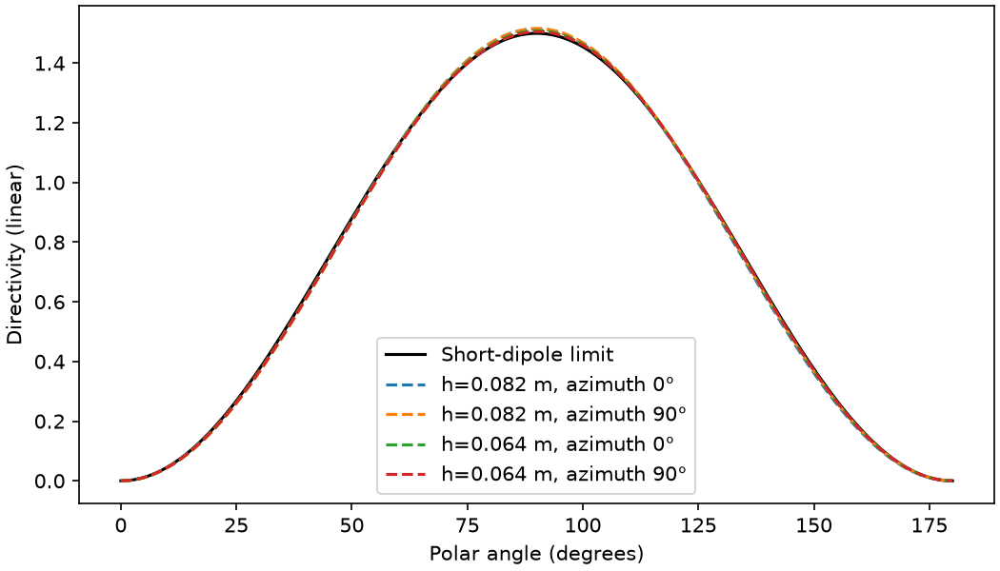

# Gap-fed cylindrical short dipole

Two PEC cylindrical arms of radius 0.003 m span z = ±0.06 m, with a 0.004 m central gap and 50 Ω feed. Free-space wavelength is 1 m. Fixed first-order tetrahedral meshes are solved with cuDSS. The far field is sampled every degree in the φ = 0° and 90° planes.

The short-wire limit is D(θ) = 1.5 sin²θ. With triangular current the approximate radiation resistance is 20π²(L/λ)² = 2.84245 Ω. The FEM estimate uses 2Pᵣₐd/|Ifeed|². The finite wire and its feed differ from the limiting current model.

| h (m) | Broadside D, φ = 90° | Worst pattern error / peak | Accepted (W) | Radiated (W) | Rrad (Ω) |
| --- | --- | --- | --- | --- | --- |
| 0.082 | 1.51591 | 1.07% | 0.0019096 | 0.0018297 | 2.2399 |
| 0.064 | 1.50543 | 0.69% | 0.0017961 | 0.0017778 | 2.3092 |



**Passed.** Finest-mesh pattern error was 0.69% of ideal peak. Radiation resistance was 18.8% below the short-wire approximation, within the 25% check. The original quadratic default run at these sizes was stopped before producing a measurement during competing GPU usage. This table records the completed first-order run.

The coarser quadratic retry at h = 0.14 m assembled a 350,188-DOF mesh including the shell. It was also stopped after roughly ten minutes without a completed solve. No quadratic measurement from this session is used in the table. The previously published square-wire variant at h = 0.12 m recorded a quadratic broadside directivity of 1.5029 and radiation resistance of 2.749 Ω; its conductor and feed geometry differ from the cylindrical model here.

[181 angular samples](data/short_dipole/comparison.csv) · [Power and resistance](data/short_dipole/power.csv) · [Benchmark and analytical reference](../../benchmarks/analytical/short_dipole.py) · [Earlier wire-geometry results](https://github.com/SolverNotConverging/FEM/blob/main/benchmarks/README.md)

## Reproduce

```sh
python benchmarks/analytical/short_dipole.py --backend gpu --element-order 1 --sizes .082 .064 --check --output results
```

[Benchmark index](README.md)
