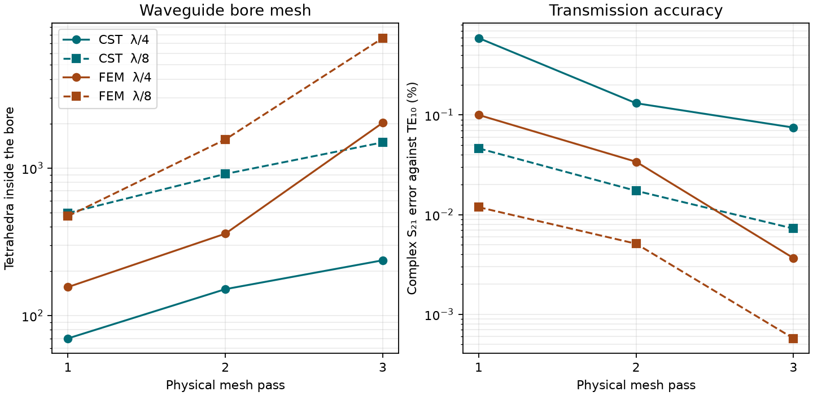

# Two-port waveguide mesh adaptation in CST and FEM

At 299.792458 MHz, both solvers reached the configured minimum of three passes for both initial mesh densities. At four cells per wavelength, CST's complex transmission error fell from 0.591% to 0.0748%. FEM's error fell from 0.100% to 0.00366%. The simulations used different domain sizes.



## Model and controls

The air-filled rectangular guide has PEC walls, a 0.72 m by 0.30 m aperture, 0.55 m port separation, and one propagating TE₁₀ channel at each end. Both ports are independently excited. The analytical reference is S₁₁ = S₂₂ = 0 and S₂₁ = S₁₂ = exp(−iβL), with β = √[(2π/λ)² − (π/0.72 m)²] and λ = 1 m. The error column uses |S₂₁ − S₂₁,exact| / |S₂₁,exact|.

| Control | CST Studio Suite 2025 | FEM |
| --- | --- | --- |
| Initial mesh | Frequency-domain tetrahedra, second order, explicit cells per wavelength in model and background | Gmsh tetrahedra, second-order field and port elements, material-aware wavelength sizing |
| Initial target | λ/4 or λ/8. An additional largest-model-edge/2 cap is 0.36 m, above both targets. | λ/4 or λ/8. The guide contains vacuum. |
| Local refinement | Frequency-domain adaptive tetrahedral solver with its automatic refinement strategy | Local field-residual marking and directional MMG3D adaptation |
| Physical convergence | At the single adaptation frequency, maximum absolute change of any complex S-matrix entry below 0.02 | Same frequency, metric and threshold |
| Pass limits | Minimum 3, maximum 8, one successful consecutive check | Minimum 3, at most 7 updates after the initial solve, one successful consecutive check |

CST solves the bounded guide bore with electric side walls and ports on its end planes. FEM uses the repository's closed PEC guide inside an antenna radiation box with one exterior PML layer. Its physical element counts include the surrounding vacuum. FEM field DOFs include the shell and constrained unknowns. CST DOFs come from its solver log. The counts describe what each solver actually computed and cannot establish a relative meshing efficiency.

## Pass histories

The figure counts only the common waveguide bore. At λ/8, FEM's bore grew from 472 to 1,563 to 7,601 tetrahedra, while CST's grew from 495 to 912 to 1,493. The table below gives each solver's full physical-domain count. [CST intermediate bore mesh](data/two_port_mesh/meshes/air8/cst/pass_2.vtu) · [FEM intermediate bore mesh](data/two_port_mesh/meshes/air8/baseline/pass_2.vtu)

| Solver | Initial target | Physical tetrahedra, passes 1 → 2 → 3 | Max ΔS, passes 2 → 3 | S₂₁ error, passes 1 → 3 |
| --- | --- | --- | --- | --- |
| CST | λ/4 | 70 → 151 → 237 | 0.004644 → 0.000805 | 0.591% → 0.0748% |
| FEM | λ/4 | 2,592 → 6,510 → 10,421 | 0.001341 → 0.000303 | 0.100% → 0.00366% |
| CST | λ/8 | 495 → 912 → 1,493 | 0.000461 → 0.000137 | 0.0463% → 0.00725% |
| FEM | λ/8 | 6,425 → 13,970 → 24,027 | 0.000177 → 0.0000454 | 0.0119% → 0.000573% |

The change passed 0.02 on pass two in every case. The minimum pass count required a third solve. The runner independently recomputes each reported ΔS from all four complex matrix entries. The CSV files contain every entry, the DOF count and the analytical transmission error at every pass. [CST λ/4](data/two_port_mesh/cst_4.csv) · [CST λ/8](data/two_port_mesh/cst_8.csv) · [FEM λ/4](data/two_port_mesh/fem_4.csv) · [FEM λ/8](data/two_port_mesh/fem_8.csv)

In a separate control, leaving CST's wavelength policy on **Automatic** and changing the near-model numeric field from 4 to 8 produced the same sequence of 62, 88 and 118 cells. Selecting **Cells per wavelength** explicitly produced the two distinct meshes above. Mesh size targets govern the initial mesh. The measured increases between passes also depend on the local refinement algorithm. For example, CST's λ/4 run grew from 70 to 151 cells on the first refinement.

## Reproduce

Measurements used the locally installed CST 2025.0 Release, build 1315043, on 27 November 2026. The CST project records the model and settings in its history. In CST, open **1D Results → Adaptive Meshing** for per-pass mesh counts and complex S-parameters. The installed Help topics **Mesh Properties (Tetrahedral)** and **Adaptive Tetrahedral Mesh Refinement (Frequency Domain)** describe the user controls.

From the repository root, run this PowerShell block to create fresh CST projects and run the FEM comparison. Choose new project filenames for repeat runs.

```powershell
$cst = 'C:/Program Files (x86)/CST Studio Suite 2025'
$runner = 'benchmarks/analytical/two_port_mesh_comparison.py'
$out = 'outputs/two_port_mesh'
$env:OPENBLAS_NUM_THREADS = '1'
foreach ($density in 4, 8) {
    .venv/Scripts/python $runner --density $density --output "$out/fem_$density.csv"
}
$env:PYTHONPATH = "$cst/AMD64/python_cst_libraries"
foreach ($density in 4, 8) {
    & "$cst/AMD64/python/python.bat" $runner --density $density --new-cst-project "$out/guide_$density.cst" --output "$out/cst_$density.csv"
}
```

To regenerate the figure from the published measurements, run:

```sh
python benchmarks/analytical/plot_two_port_mesh_comparison.py docs/benchmarks/data/two_port_mesh --output outputs/two_port_mesh/comparison.png
```

[Bore mesh exports and geometry-specific calibration](two_port_mesh_calibration.md) · [Benchmark index](README.md)
