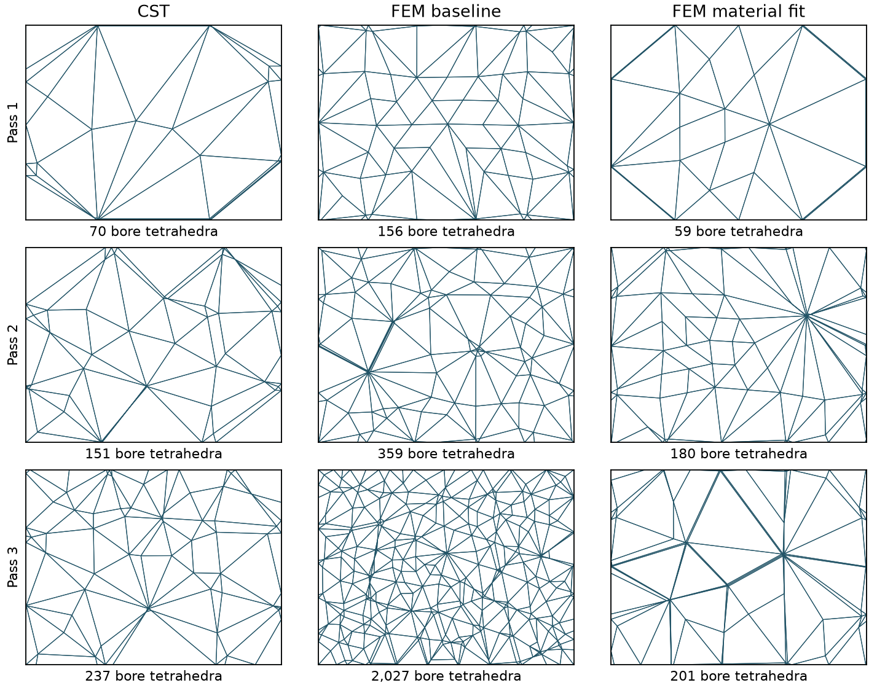
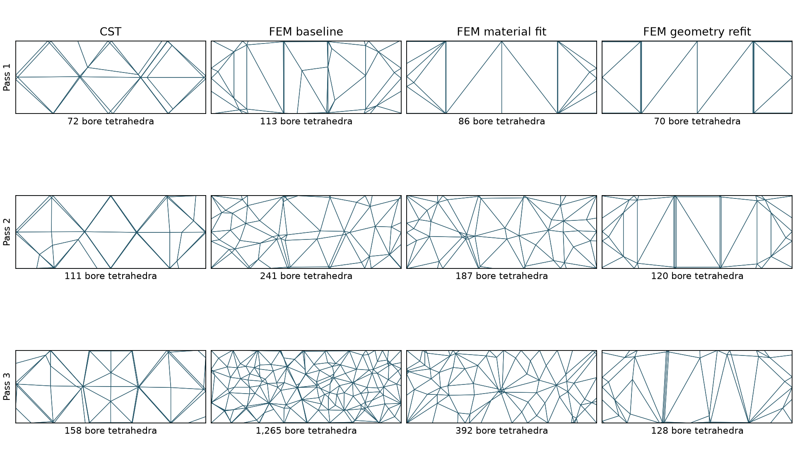

# Where CST and FEM refine a two-port waveguide

On a 0.55 m air-filled guide, CST placed 70, 151 and 237 tetrahedra inside the bore on successive passes. After tuning, FEM placed 59, 180 and 201 there. The final complex transmission errors were 0.0748% for CST and 0.0741% for FEM. Even with similar counts and transmission, the solvers put different numbers of cells near the ports. These four measured fits now supply automatic settings for matching rectangular through-guides.



The figures cut the actual tetrahedra at **y = 1 mm**. The horizontal axis spans the 0.72 m broad dimension. The vertical axis runs between the two ports. Counts below the cuts include the entire bore. Open the VTU files in ParaView to inspect other planes or the surface triangulations. [CST initial mesh](data/two_port_mesh/meshes/air/cst/pass_1.vtu) · [CST pass two](data/two_port_mesh/meshes/air/cst/pass_2.vtu) · [CST final mesh](data/two_port_mesh/meshes/air/cst/pass_3.vtu) · [Tuned FEM final mesh](data/two_port_mesh/meshes/air/tuned/pass_3.vtu)

## Geometry and measurements

All four models use the same PEC cross-section (0.72 m × 0.30 m), frequency (299.792458 MHz), second-order fields and one propagating TE₁₀ channel per port. We varied port separation and uniform relative permittivity, keeping relative permeability at one. CST used an explicit four cells per wavelength. Both solvers checked the maximum absolute change over all four complex S-parameters, with a threshold of 0.02 and a minimum of three passes. We also compared transmission against exp(−iβL), where β = √[εᵣ(2πf/c)² − (π/0.72 m)²]. [Solver setup and wavelength-density control](two_port_mesh.md)

CST solved the bounded bore. FEM also solved an exterior vacuum region and a PML, so we extracted only tetrahedra inside the bore for the spatial comparison. Each exported mesh was checked for valid connectivity, bore bounds, positive cell volumes and a total volume of 0.72 × 0.30 × L m³. The CST exports also match the adaptive result tree's mesh counts. CST retained its initial and last mesh. To obtain pass two we reran each model with a two-pass limit, then checked its cell count and four complex S-parameters against pass two of the original run (absolute differences below 10⁻⁸).

The placement metric is total variation (TV) on 18 equal-volume boxes, arranged 3 × 2 × 3 across width, height and length. Each box receives the fraction of tetrahedron centroids inside it. TV is half the sum of the absolute differences between FEM and CST fractions. A value of 0.14 means that 14% of the cell population would have to move between boxes to reproduce CST's distribution. This measures regional placement at the chosen resolution. [Per-pass bin fractions, cell volumes and counts](data/two_port_mesh/spatial_comparison.csv)

## Initial sizing and adaptive controls

On the long air guide, changing only FEM's wavelength density from 1 through 4.5 left the initial bore at 156 cells. Setting a CAD vertex size of 0.40 m and a density of 2.5 produced 59. On the long dielectric guide, a density of 3.25 and a 0.308 m CAD vertex target produced 122 cells, close to CST's 128. In FEM the local material wavelength can further reduce the vertex size. [Wavelength sweep](data/two_port_mesh/initial_sizing.csv) · [Wavelength and CAD vertex sweep](data/two_port_mesh/cad_point_sizing.csv)

For each long guide we measured 15 refinement configurations. We ranked candidates with final complex transmission error below 1% by the three-pass mean of |ln(N_FEM/N_CST)| + TV. We then applied each material's selected settings to its half-length guide. After recording those transfer results, we measured two additional scalar Gmsh settings per short geometry. The geometry refits therefore describe those individual models. [All 34 trials with settings, scores and errors](data/two_port_mesh/calibration_trials.csv)

| Fit | Cells per local wavelength | CAD vertex size (m) | Fraction of indicator sum marked | Marked diameter divisor | Refinement |
| --- | ---: | ---: | ---: | ---: | --- |
| Air | 2.5 | 0.400 | 0.50 | 2.25 | Scalar Gmsh |
| Dielectric, εᵣ = 1.44 | 3.25 | 1/3.25 | 0.12 | 1.10 | Scalar MMG3D |
| Short air refit | 2.75 | 1/2.75 | 0.50 | 1.70 | Scalar Gmsh |
| Short dielectric refit | 3.0 | 1/3 | 0.50 | 2.10 | Scalar Gmsh |

The baseline uses four cells per local wavelength, automatic CAD point sizing and directional MMG3D with a marking fraction of 0.5 and a diameter divisor of 2. All cases below reached the S-parameter stopping criterion on pass three.

| Bore | CST cells, passes 1 → 2 → 3 | Baseline FEM | FEM material fit | FEM geometry refit |
| --- | --- | --- | --- | --- |
| 0.55 m, air | 70 → 151 → 237 | 156 → 359 → 2,027 | 59 → 180 → 201 | — |
| 0.55 m, dielectric | 128 → 222 → 358 | 158 → 408 → 2,274 | 122 → 291 → 566 | — |
| 0.275 m, air | 45 → 83 → 133 | 108 → 253 → 1,183 | 42 → 133 → 156 | 42 → 116 → 110 |
| 0.275 m, dielectric | 72 → 111 → 158 | 113 → 241 → 1,265 | 86 → 187 → 392 | 70 → 120 → 128 |

| Bore | Final placement TV, baseline → material fit → geometry refit | Final analytical S₂₁ error, CST | FEM material fit | FEM geometry refit |
| --- | --- | ---: | ---: | ---: |
| 0.55 m, air | 0.141 → 0.141 → — | 0.0748% | 0.0741% | — |
| 0.55 m, dielectric | 0.096 → 0.140 → — | 0.0649% | 0.0414% | — |
| 0.275 m, air | 0.177 → 0.285 → 0.245 | 0.0208% | 0.0324% | 0.0617% |
| 0.275 m, dielectric | 0.166 → 0.230 → 0.228 | 0.0149% | 0.0175% | 0.1285% |

In the long air guide, CST increased the fraction of cells in the two end sixths from 30.0% to 38.4%. Tuned FEM went from 35.6% to 41.8%. Halving the guide changed CST's pattern: the same end regions then went from 35.6% to 25.6%. The transferred air settings put 39.1% there on the final pass. The short-air refit reduced this to 34.5%.

On the short dielectric guide, the geometry refit brought the initial count within two tetrahedra of CST and reduced the final count from 392 to 128. It also raised the transmission error and barely changed the final placement TV. For these guides, the evidence supports separate sizing and refinement controls. It gives no basis for making the fitted values universal defaults.



## Reproduction

From the repository root, use the FEM environment for these commands. The first reproduces the air fit. The second regenerates the spatial CSV and figures directly from the published meshes.

```sh
python benchmarks/analytical/two_port_mesh_comparison.py --case air --density 2.5 --cad-point-size 0.4 --marking-fraction 0.5 --refinement-factor 2.25 --metric scalar --refinement-backend gmsh --mesh-dir outputs/air_fit --output outputs/air_fit/passes.csv
python benchmarks/analytical/compare_two_port_meshes.py docs/benchmarks/data/two_port_mesh --plot-dir docs/benchmarks/plots
```

For CST, run the model generator in the installed CST Python environment as described in the wavelength study. Repeat with the same case and density, a fresh project filename and `--cst-max-passes 2`. Convert the full run and the two-pass run into the same directory with the FEM environment. The two-pass export supplies the intermediate mesh.

```sh
python benchmarks/analytical/two_port_mesh_geometry.py outputs/guide.cst outputs/guide.csv --output-dir outputs/cst_mesh
python benchmarks/analytical/two_port_mesh_geometry.py outputs/guide_two_pass.cst outputs/guide_two_pass.csv --output-dir outputs/cst_mesh
```

Use `--length .275` for the short guides. Each measurements CSV includes the complex matrix and its analytical transmission error at each pass. The exported coordinates use metres. [Short dielectric CST run](data/two_port_mesh/cst_short_loaded.csv) · [FEM geometry refit](data/two_port_mesh/geometry_fit_short_loaded.csv) · [Final refitted mesh](data/two_port_mesh/meshes/short_loaded/geometry_fit/pass_3.vtu) · [Benchmark index](README.md)
