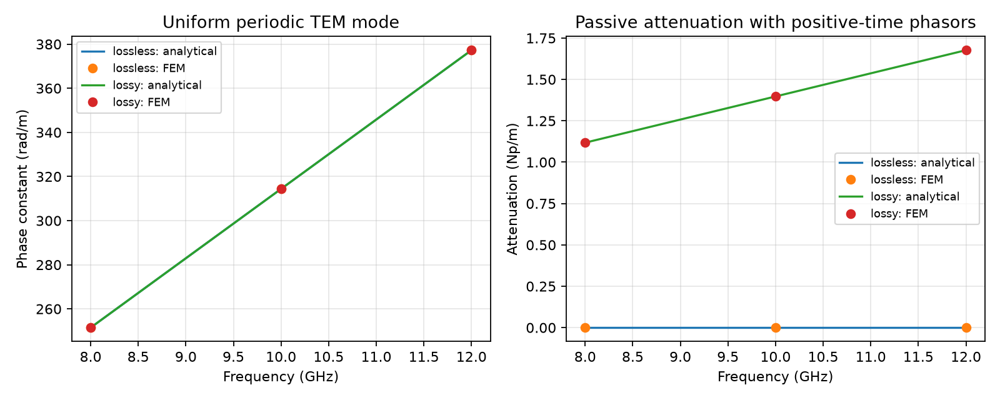

# Uniform periodic TEM medium

A PEC-bounded TM cell is 4 mm wide with a 5 mm period and a 1 mm mesh target. The relative permittivity is 2.25 in the lossless case and 2.25 − 0.02i in the lossy case. The forward TEM reference is n = √εᵣ, β = k₀ Re(n) and α = −k₀ Im(n). AMR is disabled.

**Passed.** All six complex indices agree with theory to within 2 × 10⁻¹⁴ relative error. Lossy attenuation rises with frequency as predicted; the lossless deviations are at floating-point scale. The benchmark requires less than 0.05% index error and less than 1% relative error in lossy attenuation.

| Material | Frequency (GHz) | Phase (rad/m) | Attenuation (Np/m) | Exact attenuation (Np/m) | Relative index error |
| --- | --- | --- | --- | --- | --- |
| lossless | 8 | 251.5014 | -3.30015e-14 | 0.000000 | 1.64e-14 |
| lossless | 10 | 314.3768 | -2.65608e-14 | 0.000000 | 3.55e-15 |
| lossless | 12 | 377.2521 | -6.962352e-16 | 0.000000 | 2.22e-15 |
| lossy | 8 | 251.5039 | 1.117773 | 1.117773 | 3.12e-15 |
| lossy | 10 | 314.3799 | 1.397216 | 1.397216 | 1.96e-16 |
| lossy | 12 | 377.2558 | 1.676659 | 1.676659 | 7.4e-15 |



[Current data](data/uniform_periodic_medium/comparison.csv) · [October reference](../../benchmarks/reference_results/uniform_periodic_medium/comparison.csv)

## Reproduce

```sh
python benchmarks/analytical/uniform_periodic_medium.py --check --output results
```

[Benchmark index](README.md)
