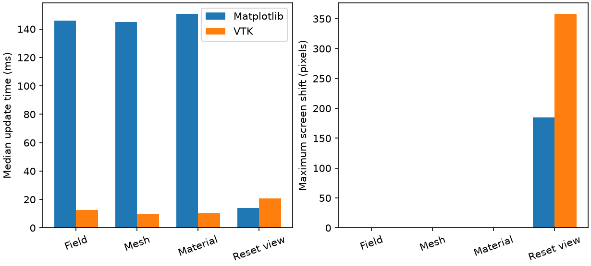

# Viewer camera stability and redraw time

A solved 1 GHz coaxial mode supplied the fields. The Qt viewer alternated Ex/Ey in Matplotlib and E/H vectors in VTK. Both views started with deliberately modified framing. The test switched fields and clicked each overlay four times, processing Qt events after each action. Three known physical points were projected onto each view. The final button click tested the explicit reset.

**Passed.** Across 24 field or overlay changes the largest measured anchor shift was zero pixels. Reset view moved the anchors by more than 100 pixels in both renderers. VTK logical pixel coordinates use the native camera projection and Qt widget dimensions so the test also works with an offscreen framebuffer.

| Renderer | Action | Samples | Median update (ms) | Max anchor shift (px) |
| --- | --- | --- | --- | --- |
| Matplotlib | Field | 4 | 146 | 0.000 |
| Matplotlib | Mesh | 4 | 145 | 0.000 |
| Matplotlib | Material | 4 | 151 | 0.000 |
| Matplotlib | Reset view | 1 | 13.8 | 185.1 |
| VTK | Field | 4 | 12.7 | 0.000 |
| VTK | Mesh | 4 | 9.87 | 0.000 |
| VTK | Material | 4 | 10.2 | 0.000 |
| VTK | Reset view | 1 | 20.6 | 358.5 |



Timing covers widget updates and Qt event processing in offscreen mode. The reset time is a single observation. This experiment measures framing and update latency for one dataset; it does not measure display refresh rate.

[Per-action measurements](data/viewer_camera/samples.csv)

## Reproduce

```sh
python benchmarks/viewer_camera.py --output results
```

[Benchmark index](README.md)
